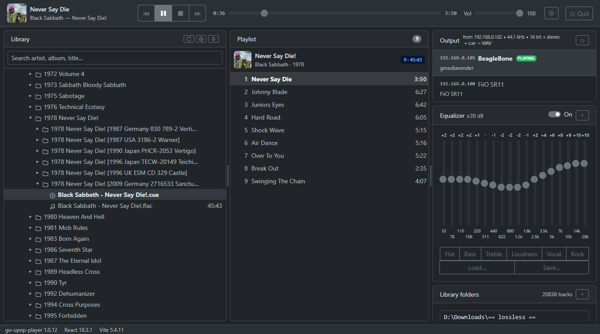

# go-upnp-player



A player for a local FLAC/CUE library that plays to network UPnP/DLNA renderers
(tested with gmrender-resurrect: a home-made streamer on a BeagleBone Green and a FiiO SR11).
A single exe: a Go/Fiber backend with a React-Bootstrap UI embedded in it, opened in the browser.

- folder tree, search, tracks from `.cue` sheets (single-file image + cue) and plain track files;
- renderer selection, play/pause/stop/seek/next/prev, renderer volume;
- 18-band equalizer: 55 Hz … 20 kHz, ±20 dB, presets; applied by the player itself, in the WAV stream;
- the same page works as a remote control from a phone on the same Wi-Fi.

How it works and why it was built this way: [docs/go-upnp-player-sad.md](docs/go-upnp-player-sad.md).

## Build

Requires Go 1.25+ and Node 20+.

```powershell
.\build.ps1
```

The result is `bin\go-upnp-player.exe`.

## Run

```powershell
bin\go-upnp-player.exe -root "D:\Music"
```

- `-root` — library folders separated by `;` (remembered; can be changed later on the page);
- `-port` — port for the UI, the API and the track streams, 8090 by default;
- `-no-browser` — do not open the browser.

Only one copy runs per machine: if the player is already running, starting it again just
opens its page in the browser and exits. A desktop shortcut to `bin/go-upnp-player.exe` is
handy. The program has no window: stop it with the **⏻ Quit** button on the page (two
clicks). It pauses the renderer first, then exits. The log goes to
`%LocalAppData%\go-upnp-player\go-upnp-player.log`.

On the first start Windows asks about the firewall — **allow it for private networks**:
renderers download tracks from this port themselves, and without the rule you get
"the command went through, but silence".

## UI development

```powershell
go run ./cmd/player -no-browser   # backend on :8090
cd web; npm run dev               # Vite proxying /api and /media to :8090
```
