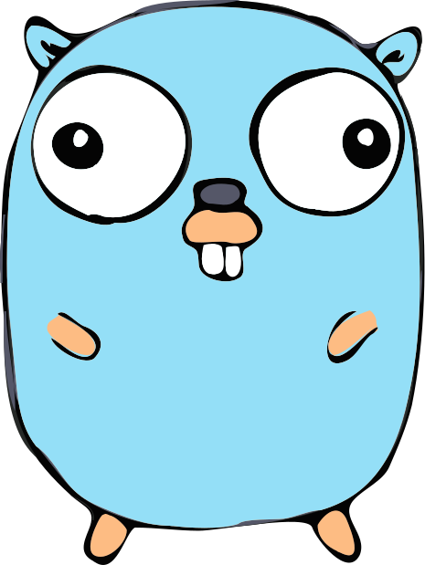
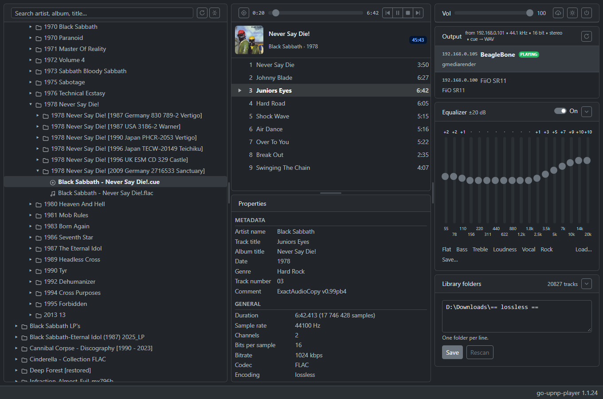

#  go-upnp-player

[](https://github.com/panedrone/go-upnp-player/actions/workflows/tests.yml)
[](https://pkg.go.dev/github.com/panedrone/go-upnp-player)
[](https://codecov.io/gh/panedrone/go-upnp-player)
[](LICENSE)



A player for a lossless library that plays to network UPnP/DLNA streamers. It does not try to play
to everything: it finds the streamers on the home network, shows them as a list and sends to the
one picked. No drivers, no output plugins: the exchange is plain HTTP and UPnP built into the
binary, so one codebase runs on Windows, Linux and macOS.

The streamer gets the original samples: no resampling, no dither, no volume on the way. Only two
things touch them, and only when they apply: the equalizer while it is on, and a 10 ms fade-in
where a stream starts mid-wave (Play, a seek), so it does not click.

FLAC files and single-file FLAC images with CUE sheets, played gapless. An optional 18-band
equalizer (55 Hz … 20 kHz, ±20 dB) reads and writes foobar2000 `.feq` presets. On Windows it
installs with a window of its own, or as a native Qt app ([go-upnp-player Qt](#the-qt-player-windows));
the zip and the `go install` builds for Linux and macOS use the browser. From a phone the same page
works as a remote.

Tested on Windows, Linux and macOS 12, with two gmrender-resurrect streamers: a home-made one on a
BeagleBone Green and a FiiO SR11. Lossy formats are not supported and will not be; DSD and other
lossless formats: [ADR-001](docs/adr-001-lossless-formats-beyond-flac.md).

**Why a streamer and not a USB DAC.** USB ties the DAC to the computer's ground, and with it to the
noise of power supplies, a graphics card and fans. Ethernet carries only data and is isolated by
transformers. The streamer buffers the stream at its leisure and feeds the DAC, which clocks the
samples out by its own oscillator: the computer is out of the audio path.

A Go (Fiber v3) server with a React page embedded in it. How it works:
[docs/go-upnp-player-sad.md](docs/go-upnp-player-sad.md). Why it is built this way, which renderer
quirks forced it and how far each is overcome: the ADRs in
[SAD §8](docs/go-upnp-player-sad.md#8-decisions-and-renderer-quirks-adr).

## Install (Windows)

Requirements: Windows 10/11 x64, a UPnP/DLNA renderer on the same network, a library of FLAC
files and/or FLAC images with `.cue` sheets.

1. Download `go-upnp-player-setup.exe` from
   [Releases](https://github.com/panedrone/go-upnp-player/releases) and run it. It installs for
   the current user, with no administrator rights: the program goes to
   `%LocalAppData%\Programs\go-upnp-player`, shortcuts to the Start menu and the desktop. Neither
   the setup nor the exe is signed, so Windows SmartScreen may say "Windows protected your PC":
   click **More info → Run anyway**. A newer setup run over an older install updates it, stopping a
   running player first.
2. Start go-upnp-player from the shortcut; the setup offers to start it at the end.

   No installer wanted: `go-upnp-player-windows-amd64.zip` from the same release holds the exe and
   its icon; unpack it into any folder and run `go-upnp-player.exe`.
3. Windows Firewall asks about network access: **allow it for private networks**. Renderers
   download tracks from the player themselves; without the rule you get "the command went through,
   but silence".
4. The player opens in a window of its own (the zip version: in the browser at
   `http://localhost:8090/`). In the **Library folders** card
   enter your music folders (one per line) and press **Save**; the library is scanned.
5. Pick a renderer in the **Output** card (press **Use** on hover), build a playlist with the
   **→** button next to a folder, a cue sheet or a track, and click a track in the playlist to
   play it (the i after a track's length shows its properties).

Optional:

- **Desktop shortcut for the zip:** right-click `go-upnp-player.exe` → *Send to → Desktop (create
  shortcut)*. For a nicer icon: shortcut *Properties → Change Icon…* → `icon.ico` from the same
  folder.
- **Pin to the taskbar:** right-click the Start menu shortcut → *Pin to taskbar*. The zip version
  has no window of its own, so pin its desktop shortcut the same way.
- **Phone as a remote:** open `http://<this PC's IP>:8090/` on a phone in the same network.

Settings live in `%AppData%\go-upnp-player\config.json`, the log and the metadata cache in
`%LocalAppData%\go-upnp-player`. To uninstall: *Settings → Apps → go-upnp-player → Uninstall*; it
asks whether to delete those two folders too. The zip version: delete its folder and those two.

### The Qt player (Windows)

The same player with a native Qt window instead of the web page: the same library, playlist,
devices, equalizer and settings. Download `go-upnp-player-qt-setup.exe` from the same release and
run it. It installs beside the usual player, to `%LocalAppData%\Programs\go-upnp-player-qt`, with
shortcuts named **go-upnp-player Qt**.

- Run one of the two at a time. They share port 8090, the settings, the playlist and the library
  cache; the one started later takes over from the other.
- The web page keeps working from any browser at `http://localhost:8090/` while the Qt player runs.
- Windows Firewall asks again for the new exe: allow it for private networks, as above.
- Its uninstaller asks whether to delete the settings and the cache too. They are shared, so that
  resets the usual player as well.

Building it yourself needs cgo and a Qt 6 SDK: the MinGW kit of Qt with the MinGW compiler of the
same version on Windows (the Qt package and `pkg-config` on Linux). The build tag keeps the usual
build and `go install` free of Qt:

```bash
go build -tags qt ./cmd/go-upnp-player-qt
```

On Windows `cli/pkg-config` stands in for `pkg-config`; see
[ADR-027](docs/adr-027-qt-window-with-miqt.md) for the whole recipe.

### With Go (any OS)

For those who prefer it, with Go 1.26+:

```bash
go install github.com/panedrone/go-upnp-player/cmd/go-upnp-player@latest
```

The binary lands in `$(go env GOPATH)/bin`. On Windows this plain command gives a console program
(a console window stays open while it runs; close it or press Ctrl+C to stop). To get the same exe
as in Releases, with no console window, add the linker flags:

```powershell
go install -ldflags "-s -w -H=windowsgui" github.com/panedrone/go-upnp-player/cmd/go-upnp-player@latest
```

macOS: see [Install (macOS)](#install-macos).

## Install (Linux)

Tested on Ubuntu 26.04. The distribution's `golang` package may be older than 1.26; the snap is
current:

```bash
sudo snap install go --classic
go install github.com/panedrone/go-upnp-player/cmd/go-upnp-player@latest
~/go/bin/go-upnp-player -root /path/to/music
```

The page opens in the default browser. Settings live in `~/.config/go-upnp-player`, the log and the
metadata cache in `~/.cache/go-upnp-player`. Ubuntu's firewall (ufw) is off by default; if it is on
and no renderers show up, allow the home network, e.g. `sudo ufw allow from 192.168.0.0/24`
(renderers answer the discovery request with incoming packets).

## Install (macOS)

Tested on macOS 12 Monterey. There is no app bundle; the player is built with Go:

1. Go from [go.dev/dl](https://go.dev/dl/), the `.pkg` for your Mac. Go 1.27 needs macOS 13, so on
   Monterey take the latest Go 1.26.
2. The player, then start it; the page opens in the default browser:

   ```bash
   CGO_ENABLED=0 go install github.com/panedrone/go-upnp-player/cmd/go-upnp-player@latest
   ~/go/bin/go-upnp-player -root /path/to/music
   ```

   The player has no C code; `CGO_ENABLED=0` keeps the build away from Xcode's tools, which macOS
   otherwise offers to install.

Settings live in `~/Library/Application Support/go-upnp-player`, the log and the metadata cache in
`~/Library/Caches/go-upnp-player`. The macOS firewall is off by default; if it is on, allow
incoming connections for go-upnp-player when asked (renderers download tracks from it).

Music on a Windows PC: *Finder → Go → Connect to Server* → `smb://<PC>/<share>`; the share
appears under `/Volumes/<share>`, which goes into **Library folders**. Windows does not share
through an account without a password; use one that has one.

## Use

- Only one copy runs per machine: starting it again brings its window to the front (or opens the
  page). After an update, the new exe stops the old one gracefully and takes over; an open page
  reloads itself.
- Installed with the setup, the player shows its UI in a window of its own (WebView2, the Edge
  engine built into Windows 10/11); closing the window quits it, minimizing just minimizes. The
  zip and `go install` versions have no window and use the browser: stop them with the **⏻ Quit**
  button on the page. Either way the renderer is stopped first, then the player exits.
- **Check for updates:** the cloud button by the version in the status bar. The player asks GitHub only
  when it is pressed. A newer version shows in the status bar with the way to get it: the setup
  copy downloads the new setup, a `go install` copy updates itself with `go install` and restarts,
  the zip version opens the release page.
- Started from cmd or PowerShell, it attaches to that console and prints Fiber's startup banner.
- Command line options:
  - `-root` — library folders separated by `;` (remembered; can be changed later on the page);
  - `-port` — port for the UI, the API and the track streams, 8090 by default;
  - `-no-browser` — do not open the browser or a window;
  - `-window` — the UI in a window of its own even outside an installed copy (Windows);
  - `-browser` — the UI in the browser even in an installed copy.

## License

[ISC](LICENSE).
