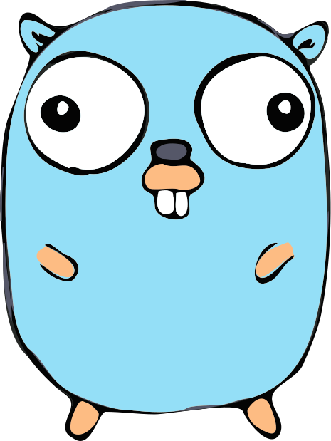
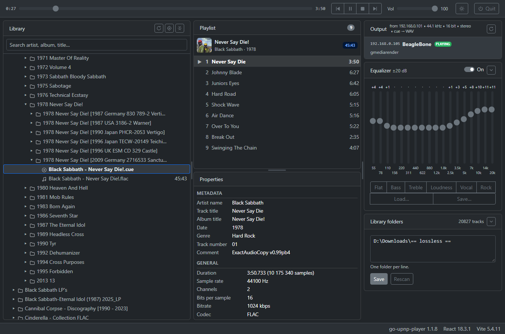

#  go-upnp-player

[](https://github.com/panedrone/go-upnp-player/actions/workflows/tests.yml)
[](https://pkg.go.dev/github.com/panedrone/go-upnp-player)
[](https://codecov.io/gh/panedrone/go-upnp-player)
[](LICENSE)



A player for a local FLAC/CUE library that plays to network UPnP/DLNA renderers
(tested with gmrender-resurrect: a home-made streamer on a BeagleBone Green and a FiiO SR11).
A single exe: a Go/Fiber v3 backend with a React-Bootstrap UI embedded in it, opened in the browser.

- folder tree, search, tracks from `.cue` sheets (single-file image + cue) and plain track files;
- renderer selection, play/pause/stop/seek/next/prev, renderer volume;
- 18-band equalizer: 55 Hz … 20 kHz, ±20 dB, presets, load/save foobar2000 `.feq` files; applied by the player itself, in the WAV stream;
- the same page works as a remote control from a phone on the same Wi-Fi.

How it works: [docs/go-upnp-player-sad.md](docs/go-upnp-player-sad.md). Why it was built this way,
which renderer quirks forced it and how far each is overcome: the ADRs listed in
[SAD §8](docs/go-upnp-player-sad.md#8-decisions-and-renderer-quirks-adr).

## Install (Windows)

Requirements: Windows 10/11 x64, a UPnP/DLNA renderer on the same network, a library of FLAC
files and/or FLAC images with `.cue` sheets.

1. Download `go-upnp-player-windows-amd64.zip` from
   [Releases](https://github.com/panedrone/go-upnp-player/releases) and unpack it into any folder,
   e.g. `C:\Programs\go-upnp-player`. Nothing else is installed.
2. Run `go-upnp-player.exe`. The exe is not signed, so on the first start Windows SmartScreen may
   say "Windows protected your PC": click **More info → Run anyway**.
3. Windows Firewall asks about network access: **allow it for private networks**. Renderers
   download tracks from the player themselves; without the rule you get "the command went through,
   but silence".
4. The player opens in the browser at `http://localhost:8090/`. In the **Library folders** card
   enter your music folders (one per line) and press **Save**; the library is scanned.
5. Pick a renderer in the **Output** card (press **Use** on hover), build a playlist with the
   **→** button next to a folder, a cue sheet or a track, and press **▶**.

Optional:

- **Desktop shortcut:** right-click `go-upnp-player.exe` → *Send to → Desktop (create shortcut)*.
  For a nicer icon: shortcut *Properties → Change Icon…* → `icon.ico` from the same folder.
- **Pin to the taskbar:** right-click the shortcut → *Show more options → Pin to taskbar*.
  The player has no window of its own, so it cannot be pinned while running.
- **Phone as a remote:** open `http://<this PC's IP>:8090/` on a phone in the same network.

Settings live in `%AppData%\go-upnp-player\config.json`, the log and the metadata cache in
`%LocalAppData%\go-upnp-player`. To uninstall, delete the program folder and those two folders.

### With Go (any OS)

For those who prefer it, with Go 1.26+:

```bash
go install github.com/panedrone/go-upnp-player/cmd/go-upnp-player@latest
```

The binary lands in `$(go env GOPATH)/bin`. On Windows this plain command gives a console program
(a console window stays open while it runs; close it or press Ctrl+C to stop). To get the same exe
as in Releases, with no console window, add the linker flags:

```powershell
go install -ldflags "-s -w -H=windowsgui" github.com/panedrone/go-upnp-player/cmd/go-upnp-player@latest
```

macOS: the same `go install` should work (the code builds for macOS and opens the page with
`open`; settings go to `~/Library/Application Support/go-upnp-player`, the log and the cache to
`~/Library/Caches/go-upnp-player`), but it has not been tested on a Mac.

## Install (Linux)

Tested on Ubuntu 26.04, including inside a VirtualBox VM. The distribution's `golang` package may be
older than 1.26; the snap is current:

```bash
sudo snap install go --classic
go install github.com/panedrone/go-upnp-player/cmd/go-upnp-player@latest
~/go/bin/go-upnp-player -root /path/to/music
```

The page opens in the default browser. Settings live in `~/.config/go-upnp-player`, the log and the
metadata cache in `~/.cache/go-upnp-player`. Ubuntu's firewall (ufw) is off by default; if it is on
and no renderers show up, allow the home network, e.g. `sudo ufw allow from 192.168.0.0/24`
(renderers answer the discovery request with incoming packets).

### In a VirtualBox VM

- **Network:** *Bridged Adapter* on the host's real network card, *Promiscuous Mode: Allow All*.
  With the default NAT, renderers neither see the VM nor can download tracks from it.
- **Music from the host:** *Shared Folders* → add the music folder with a simple name (e.g.
  `lossless`), *Read-only*, *Auto-mount*; it appears as `/media/sf_lossless`.
- In the guest: `sudo apt install virtualbox-guest-utils`, then
  `sudo usermod -aG vboxsf $USER` and **reboot** — without the `vboxsf` group the folder says
  "Permission denied".
- The first library scan over a shared folder is noticeably slower than on a local disk.
- Do not drive the same renderer from two players (host and VM) at once.

## Use

- Only one copy runs per machine: starting it again just opens the page. After an update, the
  new exe stops the old one gracefully and takes over; an open page reloads itself.
- The program has no window: stop it with the **⏻ Quit** button on the page (two clicks). It
  pauses the renderer first, then exits.
- Started from cmd or PowerShell, it attaches to that console and prints Fiber's startup banner.
- Command line options:
  - `-root` — library folders separated by `;` (remembered; can be changed later on the page);
  - `-port` — port for the UI, the API and the track streams, 8090 by default;
  - `-no-browser` — do not open the browser.

## Icon

`web/public/favicon.svg` is the source (an original drawing: a streamer box with a play badge).
`web/public/favicon-32.png`, `assets/icon-256.png` and `assets/icon.ico` are rendered from it; the
`.ico` is meant for a desktop shortcut. The exe itself has no embedded icon yet: that needs a
Windows resource (`.syso`), e.g. `go-winres simply --icon assets/icon-256.png` in `cmd/go-upnp-player`.

The Go gopher in the title (`docs/img/gopher.svg`) was designed by Renee French and is licensed
under [CC BY 4.0](https://creativecommons.org/licenses/by/4.0/); the file is taken unchanged from
[golang/website](https://github.com/golang/website/tree/master/_content/images/gophers).

## License

[ISC](LICENSE). The gopher image above is under its own license, CC BY 4.0.
