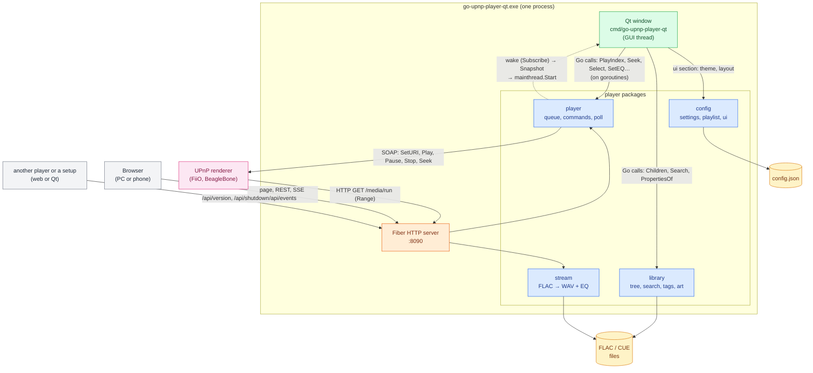

# go-upnp-player Qt — Software Architecture Document (SAD)

How the player with the Qt window is built right now. Updated in the same commit as its code. Why
it is built this way and what was rejected: [ADR-027](adr-027-qt-window-with-miqt.md). Everything
below the window (the player, the library, the streams, the renderers' quirks) is the web player's
and is described in [its SAD](go-upnp-player-sad.md).

## 1. Purpose and scope

The same player as `go-upnp-player`, with a native Qt window (miqt, Qt 6) in place of the web
page. One process holds it all: the window, the player's packages and the HTTP server.

The window needs no HTTP. It calls the player's Go packages directly and follows their state
through a wake inside the process. The HTTP server still runs because of UPnP: the player tells a
renderer "play this URL", and the renderer comes to the player for the music over HTTP. The same
server carries the few requests by which players and setups find and stop one another, and the
web page, which works from any browser while the Qt window is open.



Green is the window, blue the player's packages, orange the HTTP server, pink the renderer, gray
what comes from outside the process, yellow the files on disk. Solid arrows are calls and
requests; the dotted one is the state coming back to the window.

## 2. What goes over HTTP and what does not

| Path | Who uses it | Why |
| --- | --- | --- |
| the window → the player | the Qt window | direct Go calls in the process, no HTTP |
| the player → the window | the Qt window | `player.Subscribe`, a wake in the process, no HTTP |
| `/media/run/…`, `/media/track/…` | the renderer | UPnP: the renderer pulls the music itself; without it there is no sound |
| `/api/version`, `/api/shutdown` | a newer player, a setup | find the running player and stop it through its Quit, the position saved |
| `/api/window/show` | a second start of the same build | bring the running window to the front |
| the page, `/api/*`, `/api/events` | a browser | the web page beside the window, the same as in the web player |

## 3. Components

```
cmd/go-upnp-player-qt   the program; built only with the qt build tag
  main.go               flags, log file, one player at a time, start-up and shutdown
  window.go             the window: columns, playlist head, devices, status bar, state
  albums.go             the playlist grouped by album, the pinned album header, covers
  search.go             the search box over the tree, the results, reveal in the tree
  props.go              the Properties pane
  eq.go                 the Equalizer card
  folders.go            the Library folders card
  look.go               theme, remembered layout (the config's ui section), foldable cards
  icons.go              the transport's SVG icons, the one size of unlabelled buttons
  cursors.go            hand cursors, sliders that jump to a click
  update.go             check for updates
  icon.rc, rsrc_windows_amd64.syso   the exe's icon resource
cli/pkg-config          design-time: answers cgo from the Qt SDK's .pc files
installer/go-upnp-player-qt.iss     the Qt player's setup
```

The window calls these packages, the same as the HTTP handlers do: `player`, `library`, `config`,
`selfupdate`, `services` (the equalizer presets and `.feq` files, the album's years, the update
offer), `stream` through `player`.

## 4. State and commands

- **State.** The window subscribes to `player.Subscribe` once. The player wakes it after every
  poll of the renderer (once a second) and after every command. On a wake a goroutine takes
  `player.Snapshot()` and hands it to the GUI thread (`mainthread.Start`), where the window shows
  it: transport, position, devices, playlist, the library's state.
- **Commands.** A button or a click runs the player's command on a goroutine: many wait for the
  renderer for seconds, and the window must not freeze. The command's error goes to the status
  bar; the state comes back by the wake.
- **Slow reads** off the GUI thread as well: the search, a track's properties (its FLAC header),
  an album's cover. An answer that comes after the window has moved on is dropped.

## 5. Start-up and one player at a time

The same as `cmd/go-upnp-player`: the port is taken, or the running player answers on it.

- Another build running (the web player or an older Qt one): it is stopped through
  `/api/shutdown`, which stops the renderer and saves the position, and this one takes the port.
- The same build running: it is asked to show its window, and this start exits.
- Then the config is read, the player restores the playlist, the library is scanned, the
  renderers are looked for, and the server and the window start.
- Closing the window, the page's Quit, Ctrl+C or a takeover all end the same way: the layout is
  saved, the renderer is stopped, the position saved, the server stopped.

The settings, the playlist, the library cache and the log are the Qt player's own, apart from
the web player's: `config.UseAppDir("go-upnp-player-qt")` is the first thing in `main`, so
`config.json` is under `%AppData%\go-upnp-player-qt`, the cache and `go-upnp-player-qt.log` under
`%LocalAppData%\go-upnp-player-qt` (`~/.config` and `~/.cache` on Linux). The first start finds
no library folders: they are entered in the Library folders card. Its uninstaller offers to
delete only these two folders.

## 6. The window

- **Three columns** with splitters: the library (search box, ⟳ rescan, ⇈ collapse, the tree with
  → to make a playlist, or the search results); the playlist (⌖ show its source in the tree, the
  position and seek slider, the transport, the album header pinned over the tracks, the tracks, the
  Properties pane under a splitter); the devices (volume, ⟳ search for devices, theme, check for
  updates, the devices list, the Equalizer and Library folders cards).
- **Playlist.** Grouped by album (a cue sheet or a folder). The header shows the cover, the
  album, "artist · album's year / release's year" and the total. A click on a row plays it; the
  ⓘ shows its properties; the playing row is bold with the play arrow left of its number.
- **Status bar.** The busy message, the update check's answer with ×, the error in red; on the
  right, as a group of its own, what goes out and from where ("from 192.168.0.101 • 44.1 kHz •
  16 bit • stereo • cue → WAV"), then the version.
- **Look.** Qt's Fusion style with the page's Bootstrap colours, dark by default. Every button
  without a label is one 28×28 square; the transport's icons are the page's SVGs in the theme's
  text colour. Everything a click acts on shows the hand cursor; a click on the position or the
  volume slider puts the handle there.
- **Remembered** in the config's `ui` section: the theme, the window's place and size, the
  splitters, the folded cards and the tree's open folders (the roots open on the first run).

## 7. Build, deploy, update

- `go build -tags qt ./cmd/go-upnp-player-qt` with cgo, the Qt 6 SDK and a C++ compiler. On
  Windows: the MinGW kit of Qt and the MinGW GCC of the same version, `PKG_CONFIG` pointing to
  `cli/pkg-config`, `PKG_CONFIG_PATH` to the kit's `lib\pkgconfig`. On Linux the system's Qt
  packages and pkg-config. Without the tag the package is empty: the ordinary build, the tests
  and `go install` need no Qt.
- The first build compiles miqt's C++ bindings (minutes); later ones take seconds. The exe is
  about 26 MB.
- `windeployqt6` puts the Qt DLLs and plugins next to the exe (about 40 MB more), with
  `icon.ico`. The setup packs that folder into one file of about 18 MB, a program of its own:
  `%LocalAppData%\Programs\go-upnp-player-qt`, shortcuts "go-upnp-player Qt". It stops a running
  player through its Quit first, as the web setup does.
- Check for updates asks GitHub on the click and offers the release page in the status bar.
