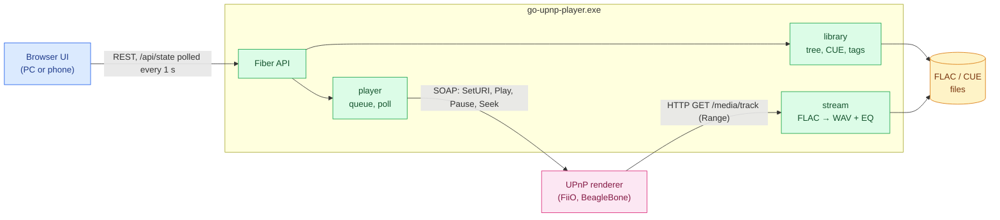

# go-upnp-player — Software Architecture Document (SAD)

How the system is built right now. Updated in the same commit as the code. Why it is built this
way, what was rejected and which renderer quirks forced it: the ADRs in §8.

## 1. Purpose and scope

A UPnP control point and a media server in one process. The program does not play sound
itself: it tells a renderer "play this URL", and the renderer downloads the track over HTTP
and decodes it on its own.



Control goes from the player to the renderer (SOAP); audio goes the other way: the renderer
pulls the track from the player over HTTP. Both renderers in use run gmrender-resurrect.

## 2. Components

```
cmd/go-upnp-player      main.go only: flags, log file, startup and shutdown order
cmd/go-upnp-player/server  routes, embedded UI (static middleware), one-instance
                        takeover, console check, version
internal/handlers/h_*   transport: request parsing, responses
internal/services/svc_* pure logic with tests: CUE, WAV geometry, Range, DIDL,
                        queue advance decision, equalizer, MIME choice
internal/upnp           SSDP discovery, SOAP AVTransport/RenderingControl/ConnectionManager
internal/stream         FLAC → WAV for a sample range (+ equalizer), raw FLAC
internal/library        folder walk, cue, tags, cover art, metadata cache
internal/player         queue and commands to the selected renderer (package-level state)
internal/bg_workers     renderer poll every second, re-discovery every minute
internal/power          keeping the PC awake while playing (Windows only)
internal/config         settings in %AppData%\go-upnp-player\config.json
internal/testkit        for tests only: generated FLAC files, a fake gmrender renderer
web/                    React + React-Bootstrap (Vite); web/dist is built at design time,
                        committed, and embedded with go:embed (so go install needs no Node)
```

**State.** Everything that must survive a browser change lives in `config.json`:

- library folders, the selected renderer and the equalizer;
- the playlist: track IDs, the current index, `source` (the tree node it was built from) and
  `position` (where Play resumes after a restart).

The browser's `localStorage` keeps only per-viewer conveniences:

- expanded tree nodes;
- whether the EQ and Library folders cards are folded;
- column widths;
- the light/dark theme (`index.html` applies it before the first paint).

**Process.**

- One instance on port 8090. A newer build replaces the running one, and open pages reload
  themselves ([ADR-012](adr-012-updates-in-place.md)).
- No console window (`-H=windowsgui`). The log goes to
  `%LocalAppData%\go-upnp-player\go-upnp-player.log`.
- Quit is the ⏻ button (two clicks) or Ctrl+C. Shutdown pauses the renderer, saves the playback
  position and stops Fiber with a 3 s timeout.
- On start the playlist is restored but not played. Play continues the current track at the saved
  position, or from the start after a user Stop.
- The status bar shows on the left what the player is busy with (a refused start being retried,
  with the attempt and the seconds left) and on the right the backend version (no `v`, no build
  id), React and Vite.

## 3. Playback flow

1. **Discovery.** M-SEARCH from every IPv4 interface, then the device description and
   `GetProtocolInfo` (which MIME types the renderer accepts).
2. **Stream URLs.** For each renderer, the local IP that routes to it (UDP dial) goes into the stream
   URLs. This keeps VPN, Hyper-V and WSL adapters out of the way.
3. **Runs, not tracks** ([ADR-016](adr-016-clicks-between-tracks-on-fiio-coax.md)). The renderer
   gets a run: the playlist from the chosen track on, for as long as the format (sample rate,
   channels, bits) stays the same, as one WAV stream. It plays the run as one song and never
   switches streams between its tracks, so its output never runs dry there. The player keeps the
   run's layout and turns the renderer's position in the stream into the track and the position in
   it for the page. A run ends where the format changes or before 3.75 GB of PCM (the RIFF size
   field); the next run is queued gapless (step 5).
   - Next, Prev, a click on a track of the run and a seek within it are a `Seek` in the stream.
     Prev goes to the previous track from anywhere in the current one, as foobar2000 does; on the
     first track, to its start.
   - A track outside the run, or a point before the stream's start, starts a new run.
   - The run's DIDL carries the first track's tags and the run's whole length.
4. **Starting a run** (`services.PlanSwitch`,
   [ADR-003](adr-003-switching-tracks-on-busy-gmrender.md)):
   - STOPPED or no media: `SetAVTransportURI(http://<ip>:8090/media/run/<run id>.wav?ct=<mime>, DIDL)`
     → `Play`. A start at a position uses a stream that begins there (`&from=<ms>`), so the renderer
     is never seeked after a start ([ADR-015](adr-015-start-at-position-as-a-stream.md));
   - PLAYING or PAUSED: `SetNextAVTransportURI(target)` → `Seek` to the last second of the current
     stream (→ `Play` if paused). The switch is confirmed by the target's length near position 0,
     with up to three attempts. That last second is another song (the end of the run, or of the
     track a paused renderer was left on), so the player first lets the old stream go: what the
     renderer fetches of it from then on is silence of the same length. The volume is never
     touched;
   - the renderer already has the requested stream: a `Seek` straight to its start.

   That is for renderers where `Stop` is not safe: the FiiO SR11, and any unknown model
   ([ADR-002](adr-002-never-stop-gmrender.md)). There the Stop button is `Pause` plus clearing the
   intent to play; the page shows STOPPED then, not the renderer's PAUSED_PLAYBACK
   (`services.ShownTransport`), and the position 0, where the next Play starts. A paused renderer
   keeps a moment of the music ready, which the next Play let out before its own start: on Stop
   the player lets the stream go (silence from then on) and seeks the renderer where it is, so
   what it holds is silence.

   Stock gmrender (model `gmediarender`, the BeagleBone) is Stop-safe and is driven the way
   foobar2000 drives it ([ADR-013](adr-013-stop-safe-renderers-start-like-foobar.md)):
   - a busy renderer is switched with `Stop` → wait for STOPPED → `SetAVTransportURI` → `Play`
     (`Play` is retried up to 4 times within ~2 s);
   - the Stop button and leaving it for another renderer send a real `Stop`.
   A start whose `Play` is still refused (`501 Playing failed`, e.g. the amplifier is not yet on the
   BeagleBone's USB input) is retried by the poll every 2 s for up to 10 s. Meanwhile the page
   shows CONNECTING, with the attempt and the seconds left in the status bar ([ADR-014](adr-014-retry-refused-start.md)).
5. **Gapless between runs.** Right after a run starts, `SetNextAVTransportURI` queues the next one.
6. **Poll** every second: `GetTransportInfo` + `GetPositionInfo` → `services.DecideTick`, all in
   the renderer's own figures, the stream's:
   - the position in the stream gives the playing track; moving into the next track of the run
     saves the playlist like any track change. If the playlist was edited and its next track is
     not the one the stream holds, that track is started instead;
   - an advance to the queued run counts when `TrackDuration` becomes its length
     ([ADR-004](adr-004-detecting-track-advance.md));
   - STOPPED more than 4 s after the player's last command starts the next run;
   - the last run has played out once its position reaches its known length, whatever the
     renderer's state: the FiiO SR11 stays in PLAYING there. The renderer is paused (or stopped,
     if Stop-safe) 2 s later;
   - the end of the playlist stops.

   After a `Seek` in the stream (a seek, Next/Prev or a click within the run) the poll takes the
   seek target as the position until the renderer reports one after it, for up to 5 s
   (`services.SeekLanded`, [ADR-017](adr-017-old-position-after-seek.md)). Seek targets and
   `RelTime` are whole seconds, so a jump to a track's start lands up to a second before it: a
   position less than 1.5 s before the playing track's start counts as its start
   (`services.TrackInStream`).

   The same poll watches for a frozen renderer ([ADR-006](adr-006-hung-gmrender.md)) and a racing
   one ([ADR-007](adr-007-racing-gmrender.md)).

   While the player plays or is starting a track (not paused, stopped or played out), the poll
   also resets the system idle timer (`SetThreadExecutionState(ES_SYSTEM_REQUIRED)`, without
   `ES_CONTINUOUS`): the stream comes from this PC, and sleep would cut the renderer off. The
   display still turns off; once playback stops, the PC sleeps by its own settings. Not done
   outside Windows yet.
7. **Switching renderers keeps the position.**
   - While playing, a run starts on the new renderer from the old position
     ([ADR-015](adr-015-start-at-position-as-a-stream.md)).
   - The player keeps where that stream starts in its first track: a seek before it restarts the
     track from there.
   - While paused, the position is remembered for the next Play.
   - The old renderer is halted (`Pause`, or `Stop` where Stop-safe) at the same time as the start
     on the new one: a renderer that does not answer does not hold the switch. A paused one keeps
     a moment of the music ready, which its next Play let out first: its stream is let go and it
     is seeked in it, so what it holds is silence (as on Stop). The transport state
     is cleared on the switch; the new renderer's own state shows after its first poll.

## 4. Serving tracks

- **A run** (`/media/run/<id>.wav`, what the renderer plays): one WAV header for the whole run,
  then the tracks' PCM back to back. The player registers a run before it hands out the URL; the
  last 16 are kept, a renderer may come back for one (a seek is a Range request). Tracks that
  continue one another in one file (a CUE image) are decoded as one range, with no seam at all.
  Between two files the equalizer's filters carry over, as if the music did. A Range request maps
  to a track and a sample in it ([ADR-016](adr-016-clicks-between-tracks-on-fiio-coax.md)).
- **Every stream starts softly:** its first 10 ms rise out of silence, as foobar2000 fades in
  after a seek. Music cut in mid-wave is a step out of silence, a click on any output. A run's
  next part goes on with no fade. With the equalizer on, decoding starts 200 ms before the first
  sample served, so the filters run in on the music instead of starting cold.
- `/media/track/<id>` serves one track, as below; the player itself no longer hands it out.
- **A track from a CUE sheet:** a virtual WAV, a 44-byte header plus the PCM of the sample range
  from its `INDEX 01` to the next track's. The length is exact. A Range request maps to a sample;
  the frame is found via SEEKTABLE, or by bisection over frame headers when there is none
  ([ADR-008](adr-008-cue-tracks-as-virtual-wav.md)).
- **A plain track file:** the FLAC file as is, with Range support. With the equalizer on, it also
  goes through WAV.
- **A start at a position:** the run's first track begins at that sample
  ([ADR-015](adr-015-start-at-position-as-a-stream.md)).
- **MIME type:** picked from the renderer's list. The BeagleBone knows only `audio/x-wav`, the FiiO
  knows `audio/wav` as well.

## 5. CUE parsing — supported

- Encodings: UTF-8 (with and without BOM), UTF-16 with BOM, otherwise cp1251 or cp1252. The code
  page is picked by decoding as both and comparing the results (`pickCodePage`).
- `FILE "x.wav"` with `x.flac` next to it; the only FLAC in the folder.
- Several `FILE` entries in one cue; EAC "gaps appended" layout (INDEX 01 under the next FILE).
- A track without INDEX 01 is dropped, not the whole sheet. Frame numbers ≥ 75 from broken rips
  are tolerated.
- A cue sheet in the `CUESHEET` tag inside a FLAC file.

Not supported:

- images other than FLAC (WAV, APE, WavPack), the binary CUESHEET block, DSD and other non-FLAC
  formats — planned in [ADR-001](adr-001-lossless-formats-beyond-flac.md);
- lossy formats (MP3, AAC, Ogg, Opus) — out of scope for good.

## 6. Equalizer

Details and reasons: [ADR-009](adr-009-equalizer-on-player-side.md).

- **Bands:** 18 half-octave bands on foobar2000's grid (55 Hz … ~19.9 kHz), ±20 dB, RBJ peaking
  biquads with Q = 2.0.
- **Overload:** no preamp. A soft limiter is linear up to −1 dBFS and rounds peaks off with tanh
  above that.
- **Presets:** foobar2000 `.feq` files are loaded and saved in the browser.
- **Live changes:** settings are an `atomic.Pointer`, and open streams pick them up from the next
  FLAC frame. After a change the player re-requests the stream from the current position.
  Switching the EQ on or off for a plain FLAC track restarts it at the same position.

## 7. UI

- **State polling.** The page polls `GET /api/state` once a second and again right after every
  command ([ADR-010](adr-010-ui-polls-state.md)). A changed `library.scans` reloads the tree and
  the playlist. The backend's state is shown as it is: a seek or volume slider shows the value
  being dragged, and from the first state asked for after the command answered, the backend's.
- **Layout.** One page, no modal dialogs:
  - three columns with splitters (`react-resizable-panels`; they stack on screens ≤ 900 px);
  - Library tree, playlist, and on the right the Output, Equalizer and Library folders cards;
  - under the playlist, behind a splitter of its own, the Properties card.
- **Library tree** ([ADR-011](adr-011-library-tree-navigation.md)):
  - folders, cue sheets and track files; cue sheets and files are leaves;
  - → on a row builds the playlist from the node without touching playback;
  - the node the playlist was built from is highlighted.
- **Library header:** the search box in place of a title, then the buttons:
  - refresh: rescan the library folders; the tree reloads in place;
  - crosshair (Alt+F1): show the playlist's source in the tree; the page does it once by itself
    when it opens;
  - Collapse All: fold everything below the library roots.
- **Controls** sit in the column they belong to: transport and seek in the
  playlist's header, which has no title (the playlist is what they play); volume, theme and Quit in a card above Output
  (volume is the selected device's). What plays is shown in the playlist: its row is bold and
  marked ▶, as in foobar2000; album headers show the total time.
- **Properties** of the playlist row clicked last (the playing track until one is clicked), as
  foobar2000's Properties without Location: Metadata (artist, title, album, date, genre, track
  number, comment) and General (duration with samples, rate, channels, bits, bitrate, codec,
  encoding, tool, embedded cuesheet, audio MD5). `GET /api/track/:id/properties` reads the FLAC
  header again on each request; vendor, MD5 and comment are not kept in the index. The bitrate of
  a cue track is its file's average.
- **Playlist and devices.** Only the playlist plays (its ▶, or Play in its header). Devices are a
  list in the Output card with a Use button. The selected device's row carries its transport badge after its name
  (a lively green for PLAYING, light gray for quiet states, PAUSED for PAUSED_PLAYBACK); the
  Output header shows a badge only when the player itself is offline. The Output title line
  also carries what is streamed and from where (local IP, rate, bits, channels, WAV or FLAC),
  parts separated by bold dots. Row buttons appear on hover and are always visible on
  touch screens.
- **Waiting for the renderer.** The ▶ and Use buttons turn into a spinner while their request
  runs. Those requests answer only after the renderer has really switched.
- **Look.** Stock Bootstrap, gray instead of blue:
  - the active row is a gray band with bold text, other rows are `text-body-secondary`;
  - buttons are `secondary` or `outline-secondary`;
  - custom CSS is limited to the slider thumbs, button sizes and `font-variant-emoji` (Windows
    draws ▶ as a blue emoji otherwise);
  - button icons are drawn SVG of one size and stroke: all are the card headers' 24 px squares
    (Quit wider, for its label). Font symbols came out in different sizes and off centre.

## 8. Decisions and renderer quirks (ADR)

Each ADR's status line says how far the problem is overcome and what is still open.

| ADR | Topic |
|---|---|
| [001](adr-001-lossless-formats-beyond-flac.md) | Lossless formats beyond FLAC (DSF/DSD, WAV, WavPack, APE, ALAC) |
| [002](adr-002-never-stop-gmrender.md) | Never send `Stop`: it hangs the FiiO SR11 |
| [003](adr-003-switching-tracks-on-busy-gmrender.md) | Switching tracks on a busy gmrender through its gapless path |
| [004](adr-004-detecting-track-advance.md) | Telling a real track advance from gmrender's early reports |
| [005](adr-005-seek-ignored-at-stream-start.md) | Repeating a seek that gmrender ignored at the start of a stream |
| [006](adr-006-hung-gmrender.md) | A hung gmrender (frozen position, `501 Playing failed`) |
| [007](adr-007-racing-gmrender.md) | A racing gmrender: no sound, position running ahead |
| [008](adr-008-cue-tracks-as-virtual-wav.md) | CUE tracks as virtual WAV; seeking without a SEEKTABLE |
| [009](adr-009-equalizer-on-player-side.md) | Equalizer on the player side, soft limiter instead of preamp |
| [010](adr-010-ui-polls-state.md) | The page polls `/api/state` instead of a push channel |
| [011](adr-011-library-tree-navigation.md) | The library tree is for choosing, the playlist is for playing |
| [012](adr-012-updates-in-place.md) | Updating in place: one instance, no stale UI, position kept |
| [013](adr-013-stop-safe-renderers-start-like-foobar.md) | Renderers that survive Stop are driven the way foobar2000 drives them |
| [014](adr-014-retry-refused-start.md) | A refused start is retried for 10 s, and the page says so |
| [015](adr-015-start-at-position-as-a-stream.md) | A start at a position is a stream that begins there |
| [016](adr-016-clicks-between-tracks-on-fiio-coax.md) | One stream for the tracks of one format, as foobar2000 sends it: no clicks between tracks |
| [017](adr-017-old-position-after-seek.md) | The renderer's old position after a seek is not taken for where it plays |

## 9. Testing

`go test -race ./...` needs no hardware, network or real user folders:

- `cmd/go-upnp-player/server/endpoints_test.go` walks the whole API through the real route table. Only
  the outside world is fake: a local HTTP server acts as the renderer, and the music is FLAC
  generated into a temporary folder. Player and library are one per process, so it is one ordered
  scenario.
- `testkit.Renderer` reproduces gmrender:
  - `SetAVTransportURI` applies only from STOPPED;
  - a seek to the end moves to the queued next URI;
  - early Seeks can be dropped;
  - a `Stop` fails the test ([ADR-002](adr-002-never-stop-gmrender.md)), unless the test makes the
    fake Stop-safe (racing, [ADR-007](adr-007-racing-gmrender.md); stock gmrender,
    [ADR-013](adr-013-stop-safe-renderers-start-like-foobar.md)).
- `testkit.IsolateUserDirs` points the config and cache directories at a temporary folder.
- Replaceable dependencies are package-level function variables (`player/seams.go`: among them
  the renderer's `GetTransportInfo`/`GetPositionInfo`/`Seek`, through which tests replay what a
  real renderer reports, e.g. its old position after a seek;
  `upnp.listLocalIPv4s`, `library.readFlacMeta`).

**Coverage.** Per-package figures show the handlers as 0%, because the endpoint scenario lives in
another package. The real number comes from
`go test -coverpkg=./cmd/...,./internal/... -coverprofile=c.out ./...`. Not covered: `main`
itself, opening a browser, and the real SSDP multicast.

**CI.** `.github/workflows/tests.yml` runs that command on Windows on every push to `master` and
sends the profile to Codecov, which feeds the README badge. `internal/testkit` is excluded from the
figure. CI needs Go only; the UI bundle comes from the repository.
