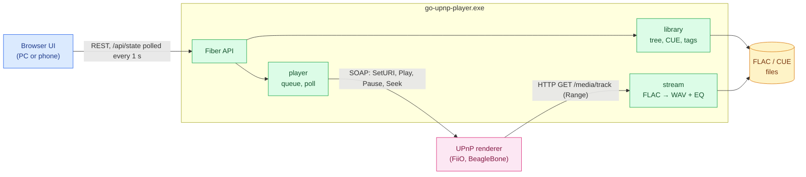

# go-upnp-player — Software Architecture Document (SAD)

A living document: how the system is built right now. It is updated in the same commit as the code.

## 1. Purpose and scope

A UPnP control point and a media server in one process. The program does not play sound
itself: it tells a renderer "play this URL", and the renderer downloads the track over HTTP
and decodes it on its own.



Control goes from the player to the renderer (SOAP); audio goes the other way: the renderer
pulls the track from the player over HTTP.

## 2. Components

```
cmd/go-upnp-player      startup: Fiber v3, routes, embedded UI (static middleware), polling
internal/handlers/h_*   transport: request parsing, responses
internal/services/svc_* pure logic with tests: CUE, WAV geometry, Range, DIDL,
                        queue advance decision, equalizer, MIME choice
internal/upnp           SSDP discovery, SOAP AVTransport/RenderingControl/ConnectionManager
internal/stream         FLAC → WAV for a sample range (+ equalizer), raw FLAC
internal/library        folder walk, cue, tags, cover art, metadata cache
internal/player         queue and commands to the selected renderer (package-level state)
internal/bg_workers     renderer poll every second, re-discovery every minute
internal/config         settings in %AppData%\go-upnp-player\config.json
internal/testkit        for tests only: generated FLAC files, a fake gmrender renderer
web/                    React + React-Bootstrap (Vite); web/dist is built at design time,
                        committed, and embedded with go:embed (so go install needs no Node)
```

The UI keeps only per-viewer conveniences in the browser's `localStorage`: expanded tree
nodes (`go-upnp-player.tree.open`), column widths (`react-resizable-panels:go-upnp-player.layout.*`)
and the light/dark theme (`go-upnp-player.theme`, toggled top right; `index.html` applies it before
the first paint so a light page does not flash dark).
The column splitters come from `react-resizable-panels`: Bootstrap/React-Bootstrap have no such
component. On a narrow screen (≤ 900 px) the columns stack and the splitters become horizontal.
Everything that must survive a browser change lives in `config.json` on the program side.

The status bar at the bottom of the page shows the backend's version, taken from the player
state (no `v` and no build id: the build id is for self-update only), and the React and Vite versions the bundle was built with.

**No console, quit from the UI.** The exe is built with `-H=windowsgui`; the log goes to
`%LocalAppData%\go-upnp-player\go-upnp-player.log`. `POST /api/shutdown` (the ⏻ Quit button, two
clicks) takes the same path as Ctrl+C: pause the renderer, then
`app.ShutdownWithTimeout(3s)`. The timeout is needed because track streams never end
on their own. ~~A minimized console window as the way to stop it~~ — rejected 2026-11-09: the
window sits on the taskbar and is awkward to close.

**The playlist survives restarts.** The playlist (track IDs) and the current track index are
stored in `config.json` (`playlist`). They are written when a playlist is built with the arrow
button, when a track starts and when playback advances to the next track. On start the playlist
is restored but not played: Play resumes from the same track. The UI re-reads the playlist when
the library scan finishes, because IDs do not resolve to tracks until then.

**Single instance, replaced on update.** On start the process first binds the port (8090). If the
port is busy and `/api/state` of go-upnp-player answers on it, the process compares builds via
`/api/version` (a short SHA-256 of the exe file):
- same build: it opens the browser on the running player and exits with code 0;
- different build, or no `/api/version` (older builds): it calls `/api/shutdown` on the running
  player (renderer paused first) and binds the port as soon as it is free. Without this, a shortcut
  click after an update kept opening the old running player and its old UI (2026-11-09).

If something else answers on the port, it is an error. A named mutex is not needed: a busy port
would stop a second copy from working anyway.

**Rename from upnp-player (2026-11-09).** The project, module, exe and data folders are now
`go-upnp-player`. Files from the old folders are read once as a fallback, so nothing is lost on
upgrade: `config.json` from `%AppData%\upnp-player` (the next save writes the new folder), the
metadata cache from `%LocalAppData%\upnp-player`, and the `upnp-player.tree.open` localStorage key.
Saved column widths are not carried over (they reset to the defaults once).

## 3. Playback flow

1. `Discover`: M-SEARCH from every IPv4 interface, then the device description and
   `GetProtocolInfo` (which MIME types the renderer accepts).
2. For each renderer the local IP that routes to it is determined (UDP dial). That address goes
   into the track URLs, so VPN, Hyper-V and WSL adapters do not get in the way.
3. Starting a track depends on the renderer state (`PlanSwitch`):
   - STOPPED / no media: `SetAVTransportURI(http://<ip>:8090/media/track/<id>.wav|.flac?ct=<mime>, DIDL)` → `Play`;
   - PLAYING or PAUSED: `SetNextAVTransportURI(target)` → `Seek` to the last second of the current
     track (→ `Play` if paused); the renderer moves to the target through its gapless path, and the
     player waits until the renderer reports the target's length near position 0 before queuing
     the following track. If the renderer had already pulled a previously queued "next" into its
     buffer, it lands on that track instead; the switch is then repeated (up to three attempts);
   - the renderer already has the requested track (same URI and same audible length): it is
     restarted in place with `Seek(0)` (+ `Play` if paused).
     Reason (2026-11-09, both renderers run gmrender): gmrender applies `SetAVTransportURI` only
     from STOPPED — while playing or paused it keeps the old song — and `Stop` hangs the FiiO SR11
     until a power cycle, from pause too. ~~SetAVTransportURI while playing~~,
     ~~Play to resume, then SetAVTransportURI~~ and ~~Pause → Stop → SetAVTransportURI~~ were
     tried live and rejected for those reasons.
4. Right after a track starts, `SetNextAVTransportURI` is sent for the next one (gapless).
   If the renderer does not support it, the poll performs the transition.
5. Poll every second: `GetTransportInfo` + `GetPositionInfo` → `DecideTick`:
   - the renderer moved to the next URI by itself — advance the index. A `TrackURI` change
     alone is not enough: gmrender (FiiO SR11, seen live 2026-11-09) reports the next track as
     current as soon as GStreamer has downloaded the current WAV into its buffer — minutes before
     the real transition — and also resets RelTime by a couple of seconds. The transition counts
     when `TrackDuration` becomes the next track's length; a position jump back counts only if
     both tracks have the same length;
   - STOPPED later than 4 s after our command — start the next track;
   - end of the queue — stop.

**Switching renderers keeps the position.** While playing, the track is started on the new
renderer and seeked to the old position; the seek is repeated until the renderer reports that
position, because gmrender silently ignores a Seek in the first moments of a stream (it used to
restart the track from 0). While paused, the position is remembered and the next Play starts the
track on the new renderer there. Stop clears it ("start over").

**The UI's `index.html` is served with `Cache-Control: no-cache`.** Embedded files have a zero
modification time, and the browser kept a stale `index.html` pointing at the previous build's
hashed bundle: after an update the page came up blank (2026-11-09). An `index.html` cached before
this fix is never revalidated by the browser. `no-cache` alone was not enough: with a zero
modification time every conditional request got a 304, so `If-Modified-Since` is now dropped for
`index.html` (2026-11-09). When an old copy asks for the bundle of a build that no
longer exists (`/assets/index-*.js`), the server answers with a tiny script instead of a 404: it
refetches `index.html` with `cache: "reload"` (which replaces the cached copy) and reloads the
page. If the old bundle is cached too, the old UI shows and only a hard reload (Ctrl+F5) helps.

**The UI reloads itself after an update.** `/api/state` carries the build
id; when an open page sees a different build than the one it started with, it reloads. Otherwise a
page left open across an update kept its stale state (expanded tree folders never refetched).

## 4. Serving tracks

- **A track from a CUE sheet** — a virtual WAV: a 44-byte header plus the PCM of the sample range
  `[INDEX 01 of the track; INDEX 01 of the next one)`. The next track's pregap stays at the end of
  the previous one. The length is known exactly, so `Content-Length` is honest. A Range request is
  mapped to a sample number: the decoder seeks to the frame via SEEKTABLE and drops the excess.
  Without a SEEKTABLE it bisects over frame headers (jump into the byte range, find the next
  valid frame header by sync code and CRC-8, compare its sample number, narrow) instead of
  decoding from the start: a 24/192 track went from 7.9 s to 0.23 s for a Range at 5 minutes,
  and a track switch (which seeks to the end of the current track) from ~19 s to ~2 s
  (2026-11-09). Bytes are identical to a sequential decode (covered by a test that encodes a
  FLAC without a SEEKTABLE).
- **A plain track file** — the FLAC file as is, with Range support. With the equalizer on it also
  goes through WAV.
- The MIME type is picked from the renderer's list: the BeagleBone knows only `audio/x-wav`,
  the FiiO knows `audio/wav` as well.

## 5. CUE parsing — supported

- encodings: UTF-8 (with and without BOM), UTF-16 with BOM, otherwise cp1251 or cp1252, picked
  by decoding as both and comparing the results (`pickCodePage`);
- `FILE "x.wav"` with `x.flac` next to it; the only FLAC in the folder;
- several `FILE` entries in one cue; EAC "gaps appended" layout (INDEX 01 under the next FILE);
- a track without INDEX 01 is dropped, not the whole sheet; frame numbers ≥ 75 from broken rips
  are tolerated;
- a cue sheet in the `CUESHEET` tag inside a FLAC file.

Not supported: images other than FLAC (WAV, APE, WavPack), the binary CUESHEET block, DSD and other
non-FLAC formats — planned in [ADR-001](adr-001-lossless-formats-beyond-flac.md) (proposed). Lossy formats
(MP3, AAC, Ogg, Opus) are out of scope for good.

## 6. Equalizer

18 half-octave bands (55·2^(n/2): 55 Hz … ~19.9 kHz), ±20 dB, peaking biquads from the
RBJ Audio EQ Cookbook, Q = 2.0 (the textbook half-octave Q of 2.87 leaves dips between adjacent
bands). A band is skipped only above 0.475·fs, so the top band works at 44.1 kHz too. A saved set
for a different band grid is not remapped but reset to zero. ~~10 bands 31 Hz … 16 kHz,
±12 dB~~ — 2026-11-09: not enough.

The grid is exactly foobar2000's, so its `.feq` presets (one integer dB per line, 18 lines,
CRLF) load and save index by index, entirely in the browser: Load reads the file picked in the
file input, Save uses the browser's "Save as" where available (Chromium), otherwise a download.
A file with a different number of values is refused, not remapped. ~~Built-in Hard and Soft
presets~~ — replaced by `.feq` load/save 2026-11-09: the owner's own curves live in foobar2000.

There is no overall attenuation: boosting a band raises that band and leaves the rest alone.
Overload is handled by a soft limiter: linear up to −1 dBFS, above that peaks are rounded off
with tanh and never exceed full scale. ~~Preamp = −(largest boost)~~ — rejected 2026-11-09:
a +18 dB treble boost turned into "the whole track −18 dB, treble unchanged", i.e. near silence
instead of sparkle. Measured on "Never Say Die" with those settings: loudness +1.6 dB instead
of −18.

The settings live in an `atomic.Pointer`: open streams pick them up from the next FLAC frame.
The renderer buffers several seconds, so after a change the player re-requests the stream from
the current position (Seek). Turning the EQ on or off for a plain FLAC track changes the stream
type, so the track is restarted at the same position.

## 7. Decisions and rejected alternatives

- **Cut CUE tracks on the program side instead of serving the whole image + Seek.** Time-based
  seeking on renderers is imprecise, and the display would show the length of the whole album.
- **EQ on the program side.** gmrender's UPnP RenderingControl offers volume only.
- ~~`Stop` before `SetAVTransportURI`~~ and ~~`Stop` for the Stop button~~ — rejected 2026-11-09.
  On `AVTransport.Stop` during playback the FiiO SR11 brought its whole UPnP service down until
  a power cycle (a live incident). The Stop button now sends `Pause` and clears the intent to
  play; the next Play starts the track over. When switching renderers, the old one also gets
  `Pause`.
- **The page polls `GET /api/state` once a second**, and once more right after every command. The
  backend polls the renderer at the same rate, so a faster poll would show nothing new.
  ~~SSE (`/api/events`) pushing a snapshot on every change~~ — dropped 2026-11-09 at the owner's
  request: a long-lived channel hides what the page is shown and when; a plain request per
  reading is visible in the browser's network log and needs no keepalive.
- **No modal dialogs**: everything is on one page (device, EQ and folders are cards on the right).
- **Navigation is the folder tree only.** Folders with nothing playable inside are hidden. A cue
  sheet expands into its tracks; track files are leaves. Nothing plays from the tree: the arrow
  button → on each row builds a playlist (a folder or a cue — everything inside; a file or a
  track — just that one; `PUT /api/queue`, playback is untouched). Only the playlist in the middle
  plays: the ▶ button on a track or Play in the top bar. Row buttons (→ in the tree, ▶ in the
  playlist) pop up on hover right after the label and are always visible on touch screens.
  Devices are a list in the Output card, selected with a Use button on hover.
  The crosshair button in the Library header (or Alt+F1), like "Select Opened File" in JetBrains
  IDEs, shows the playing track in the tree: it clears the search, expands the folders down to the
  track (and its cue sheet), scrolls to it and flashes the row. The button next to it, like
  "Collapse All", collapses everything below the library roots; the roots stay open, otherwise a
  single library folder would leave one row.
  Rejected 2026-11-09: ~~double-click on a playlist track~~; ~~a dropdown for devices~~;
  ~~a central list of all tracks under the selected folder~~ (large folders produced thousands of
  rows to scroll); ~~double-click in the tree starts playback~~ (the tree is for navigation, the
  playlist is what plays).

## 8. Known issues

- The BeagleBone (gmrender) answers `Play` with `501 Playing failed` and does not even request the
  file (2026-11-09). The failure happens before any network access, inside GStreamer on the device:
  a busy ALSA output or a missing HTTP source element. Check the gmediarender log on the BeagleBone.
- ~~Without a SEEKTABLE every Range request decodes the file from the start~~ — fixed
  2026-11-09 by bisection over frame headers (§4).
- ~~Every scanned FLAC stayed open until a garbage collection~~ — fixed 2026-11-09, found by a
  test that could not delete its temporary file on Windows. `flac.ParseFile` opens the file, but
  `Stream.Close` closes nothing because the stream holds a `bufio.Reader`. The library now opens
  and closes the file itself and calls `flac.Parse`.

- gmrender can hang in PLAYING with a frozen position (BeagleBone, 2026-11-09, trigger not
  established) and then accepts every command without effect. The player cannot repair it: `Stop`
  is ruled out (§7), so the device or `gmediarender` has to be restarted. What the player does:
  a position unchanged for 8 s while PLAYING is reported as `stalled` (the UI shows STALLED and a
  Play button instead of Pause), Play on such a renderer goes through a real track start, and a
  switch that fails after three attempts is an error. ~~Report the start as successful anyway~~
  and ~~trust the renderer's PLAYING~~ showed "playing" over silence.
- gmrender can also *race*: PLAYING, no sound, the position running at 30–40x and the queue
  flying by (BeagleBone, switching back to it from the FiiO, 2026-11-09; trigger not
  established — a 60 s pause, a restart of the player and the switch path itself, all tried on
  a healthy device, did not cause it). Pause/Play does not cure it; Stop → SetAVTransportURI →
  Play does (that is what foobar2000 does on a new start, which is how the owner recovered it;
  ~~restart the renderer~~ was the wrong advice). The poll sees it as a position that grew more
  than 1.5 s per second + 1.5 s within one track, on three polls in a row (a jump can be a seek
  that landed late; RelTime's whole seconds make a 1 s poll show 2 s at most), and restarts the
  track that way from where the racing began, with a line in the log. ~~3 s per second + 3 s, two
  polls~~ — 2026-11-09: the racing speed is whatever the download allows, 30–40x once but ~5x the
  next time, which went unnoticed in 1.0.4. This is the one
  place `Stop` is sent: the renderer plays nothing anyway. If it races again within 2 minutes,
  it is paused and reported instead of being stopped again.
- In the same state the BeagleBone may answer every `Play` with `501 Playing failed`. The poll
  used to start the next track again on every tick (108 attempts in two minutes); a failed
  automatic start now clears the intent to play and shows the error.

## 9. Testing

`go test -race ./...` needs no hardware, network or real user folders:

- `cmd/go-upnp-player/endpoints_test.go` walks the whole API through the real route table. Only
  the outside world is fake: a local HTTP server acts as the renderer, the music is FLAC generated
  into a temporary folder. Player and library are one per process, so it is one ordered scenario.
- `testkit.Renderer` reproduces the gmrender behaviour from §3: `SetAVTransportURI` applies only
  from STOPPED, a seek to the end moves to the queued next URI, early Seeks can be dropped. A
  `Stop` fails the test, which keeps the FiiO SR11 rule (§7) enforced; only the racing-renderer
  tests (§8) allow it explicitly.
- `testkit.IsolateUserDirs` points the config and cache directories at a temporary folder.
- Replaceable dependencies are package-level function variables (`player/seams.go`,
  `upnp.listLocalIPv4s`, `library.readFlacMeta`).

The handlers are covered by the endpoint scenario, which lives in another package, so per-package
figures show them as 0%. For the real number use
`go test -coverpkg=./cmd/...,./internal/... -coverprofile=c.out ./...`. Not covered: `main` itself,
opening a browser, and the real SSDP multicast.

CI (`.github/workflows/tests.yml`, Windows) runs that command on every push to `master` and sends
the profile to Codecov, which feeds the README badge. `internal/testkit` is excluded from the
figure. CI needs Go only; the UI bundle comes from the repository.
