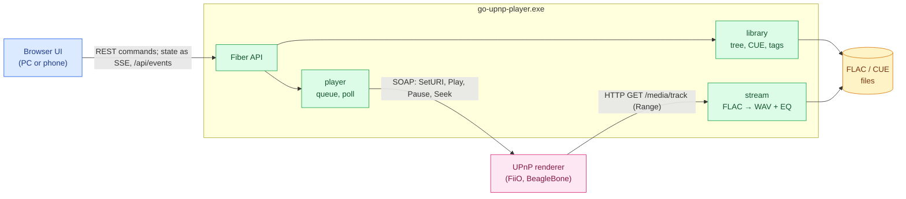

# go-upnp-player — Software Architecture Document (SAD)

How the system is built right now. Updated in the same commit as the code. Why it is built this
way, what was rejected and which renderer quirks forced it: the ADRs in §8. The player with the
Qt window has a SAD of its own: [go-upnp-player-qt-sad.md](go-upnp-player-qt-sad.md).

## 1. Purpose and scope

A UPnP control point and a media server in one process. The program does not play sound
itself: it tells a renderer "play this URL", and the renderer downloads the track over HTTP
and decodes it on its own.



Control goes from the player to the renderer (SOAP); audio goes the other way: the renderer
pulls the track from the player over HTTP. Both renderers in use run gmrender-resurrect.

## 2. Components

```
cmd/go-upnp-player      main.go only: flags, log file, startup and shutdown order
cmd/go-upnp-player/server  routes, embedded UI (static middleware), one-instance
                        takeover, console check, version
cmd/go-upnp-player/window  the UI in a window of its own (WebView2, Windows only)
cmd/go-upnp-player-qt   the player with a Qt window (miqt) calling the packages directly;
                        built only with the qt tag (ADR-027)
cli/pkg-config          design-time: answers cgo from Qt's .pc files when building the Qt window
installer/*.iss         Inno Setup scripts: the web player's setup and the Qt player's (ADR-027)
internal/handlers/h_*   transport: request parsing, responses
internal/services/svc_* pure logic with tests: CUE, WAV geometry, Range, DIDL,
                        queue advance decision, equalizer, MIME choice
internal/upnp           SSDP discovery, SOAP AVTransport/RenderingControl/ConnectionManager
internal/stream         FLAC → WAV for a sample range (+ equalizer), raw FLAC
internal/library        folder walk, cue, tags, cover art, metadata cache
internal/player         queue and commands to the selected renderer (package-level state)
internal/bg_workers     renderer poll every second, re-discovery every minute, the auto scan
internal/power          keeping the PC awake while playing (Windows only)
internal/selfupdate     the update check (GitHub's latest release) and go install of a new
                        version, only on the user's click
internal/config         settings in %AppData%\go-upnp-player\config.json
internal/testkit        for tests only: generated FLAC files, a fake gmrender renderer
web/                    React + React-Bootstrap (Vite); web/dist is built at design time,
                        committed, and embedded with go:embed (so go install needs no Node);
                        -web <folder> serves it from disk instead (development; the status
                        bar shows a gold dev badge and the listening address)
installer/              Windows installer script (Inno Setup 6), built at design time
```

**Windows installer.** `ISCC /DAppVersion=X.Y.Z installer\go-upnp-player.iss` from the repository
root, after the release exe is built into `bin\`, gives `bin\go-upnp-player-setup.exe`. It
installs per user, without administrator rights, into `%LocalAppData%\Programs\go-upnp-player`,
with Start menu and desktop shortcuts and an entry in Settings → Apps. An installed copy (an `unins000.exe` next to
the exe) shows the UI in its own window ([ADR-018](adr-018-own-window-via-webview2.md)): closing
it quits the player, a second start brings it to the front; `-browser` and `-window` override. A running player on port
8090 is stopped through `/api/shutdown`, like its Quit (renderer stopped, position saved), not
killed: the Restart Manager is off. The uninstaller removes the program and its shortcuts; it asks
whether to delete the settings and the library cache too, and keeps them when silent. Not in CI:
CI needs Go only.

**State.** Everything that must survive a browser change lives in `config.json`:

- library folders, the selected renderer and the equalizer;
- how DSD is converted (`dsd.json`, a file of its own beside `config.json`: PCM rate and gain);
- starred folders (`starred`, by path);
- where the player's own window was and whether it was maximized;
- the playlist: track IDs, the current index, `source` (the tree node it was built from) and
  `position` (where Play resumes after a restart).

The browser's `localStorage` keeps only per-viewer conveniences:

- expanded tree nodes;
- whether the EQ and Library folders cards are folded;
- column widths;
- the light/dark theme (`index.html` applies it before the first paint).

**Process.**

- One instance on port 8090. Another build replaces the running one, unless the running one is
  a newer version: then the started copy just shows it and exits. Open pages reload themselves
  ([ADR-012](adr-012-updates-in-place.md)). The own window's title is the name alone, no version.
- No console window (`-H=windowsgui`). The log goes to
  `%LocalAppData%\go-upnp-player\go-upnp-player.log`.
- Quit is the ⏻ button (one click, no confirmation) or Ctrl+C. Shutdown stops the renderer
  (ADR-025), saves the playback position and stops Fiber with a 3 s timeout.
- On start the playlist is restored but not played. Play continues the current track at the saved
  position, or from the start after a user Stop.
- The status bar shows on the left what the player is busy with (a refused start being retried,
  with the attempt and the seconds left), then the latest error in red in an area of its own
  (at most half the bar, the full text in its tooltip; it overwrites nothing, and the Output card
  no longer stretches for it), then the answer about updates in an area of its own just left of
  the cloud button (it never hides what the player is busy with), and on the right the player's
  version alone (no name, no `v`, no build id). React and Vite versions are not shown: they only tell an outsider what the UI is built
  with.

## 3. Playback flow

1. **Discovery.** M-SEARCH from every IPv4 interface, then the device description and
   `GetProtocolInfo` (which MIME types the renderer accepts). The Output card's Refresh rebuilds
   the list (a 3 s wait). Its **Scan** switch (`PUT /api/renderers/auto`, off on every start)
   searches once a second with a 1 s wait, for a renderer being rebooted: it adds new devices,
   drops one not heard for 5 s (unplugged; one lost answer does not drop it), does not fetch a known device's description
   again, and runs until it is turned off (a renderer may take minutes to boot).
2. **Stream URLs.** For each renderer, the local IP that routes to it (UDP dial) goes into the stream
   URLs. This keeps VPN, Hyper-V and WSL adapters out of the way.
3. **Runs, not tracks** ([ADR-016](adr-016-clicks-between-tracks-on-fiio-coax.md)). The renderer
   gets a run: the playlist's tracks of one format (sample rate, channels, bits) around the chosen
   one, as one WAV stream. A start opens the run at the first of the tracks before the chosen one
   that go on in the same format, so that a jump back within the album is a seek too
   ([ADR-020](adr-020-every-jump-within-an-album-is-a-seek.md)); the run's first request plays
   those earlier tracks as silence, and the start seeks to the chosen track (repeated until it
   lands, ADR-005). The queued next run starts where the format changes. It plays the run as one song and never
   switches streams between its tracks, so its output never runs dry there. The player keeps the
   run's layout and turns the renderer's position in the stream into the track and the position in
   it for the page. A run ends where the format changes or before 3.75 GB of PCM (the RIFF size
   field); the next run is queued gapless (step 5).
   - Next, Prev, a click on a track of the run and a seek within it reach it within the stream.
     While music plays, the renderer is first paused on silence (`Pause`, its stream let go and
     the renderer seeked where it stands), then restarted in place at the target, every step sent
     only once the renderer reported the previous one done
     ([ADR-022](adr-022-a-jump-is-stop-then-start.md)). This is a transition of its own, not the
     Stop button: the output stays open ([ADR-025](adr-025-stop-is-stop.md)). While paused, a
     plain `Seek`.
     Prev goes to the previous track from anywhere in the current one, as foobar2000 does; on the
     first track, to its start.
   - A track outside the run, or a point before the stream's start, starts a new run.
   - The run's DIDL carries the chosen track's tags and the run's whole length.
   - One position report far behind the last one (gmrender's odd `0:00:00`) is not acted on; the
     same on the next poll is ([ADR-020](adr-020-every-jump-within-an-album-is-a-seek.md)).
4. **Starting a run** (`services.PlanSwitch`,
   [ADR-003](adr-003-switching-tracks-on-busy-gmrender.md)):
   - STOPPED or no media: `SetAVTransportURI(http://<ip>:8090/media/run/<run id>.wav?ct=<mime>, DIDL)`
     → `Play`. The stream begins at the chosen track, or at the position in it
     ([ADR-015](adr-015-start-at-position-as-a-stream.md)): no lead, no seek
     ([ADR-024](adr-024-a-start-takes-what-the-renderer-holds.md));
   - a renderer that holds the player's current stream (its URI and length) with the chosen track
     in it: a restart in place, a `Seek` there (paused: then `Play`), confirmed
     ([ADR-022](adr-022-a-jump-is-stop-then-start.md));
   - PLAYING or PAUSED with any other stream: `Stop` → STOPPED reported → `SetAVTransportURI` →
     `Play`, as foobar2000 starts it, on every renderer alike
     ([ADR-025](adr-025-stop-is-stop.md)). `Play` is retried up to 4 times within ~2 s.

   **Stop.** Every `Stop` the player sends goes the same way (`stopRenderer`): the renderer's state
   is asked first, and one already STOPPED gets nothing; otherwise one `Stop`, never repeated, then
   only polls until it reports STOPPED. The Stop button is a real `Stop` on every renderer, with
   the intent to play cleared; the page shows the position 0, where the next Play starts. The
   state badge shows what the renderer itself reports, never the player's intent.
   A start whose `Play` is still refused (`501 Playing failed`, e.g. the amplifier is not yet on the
   BeagleBone's USB input) is retried by the poll every 2 s for up to 10 s. Meanwhile the page
   shows CONNECTING, with the attempt and the seconds left in the status bar ([ADR-014](adr-014-retry-refused-start.md)).
5. **Gapless between runs.** Right after a run starts, `SetNextAVTransportURI` queues the next one.
6. **Poll** every second: `GetTransportInfo` + `GetPositionInfo` → `services.DecideTick`, all in
   the renderer's own figures, the stream's:
   - the position in the stream gives the playing track; moving into the next track of the run
     saves the playlist like any track change. If the playlist was edited and its next track is
     not the one the stream holds, that track is started instead;
   - an advance to the queued run counts when `TrackDuration` becomes its length
     ([ADR-004](adr-004-detecting-track-advance.md));
   - STOPPED more than 4 s after the player's last command starts the next run;
   - the last run has played out once its position reaches its known length, whatever the
     renderer's state: the FiiO SR11 stays in PLAYING there. 2 s later the renderer is switched
     off: Stop, confirmed STOPPED, and the player forgets the stream and the position. The
     page shows the slider with no thumb until the next start, which comes from STOPPED
     ([ADR-023](adr-023-the-end-of-the-playlist-switches-off.md));
   - the end of the playlist stops.

   After a `Seek` in the stream (a seek, Next/Prev or a click within the run) the poll takes the
   seek target as the position until the renderer reports one after it, for up to 5 s
   (`services.SeekLanded`, [ADR-017](adr-017-old-position-after-seek.md)). Seek targets and
   `RelTime` are whole seconds, so a jump to a track's start lands up to a second before it: a
   position less than 1.5 s before the playing track's start counts as its start
   (`services.TrackInStream`).

   The same poll watches for a frozen renderer ([ADR-006](adr-006-hung-gmrender.md)) and a racing
   one ([ADR-007](adr-007-racing-gmrender.md)).

   While the player plays or is starting a track (not paused, stopped or played out), the poll
   also resets the system idle timer (`SetThreadExecutionState(ES_SYSTEM_REQUIRED)`, without
   `ES_CONTINUOUS`): the stream comes from this PC, and sleep would cut the renderer off. The
   display still turns off; once playback stops, the PC sleeps by its own settings. Not done
   outside Windows yet.
7. **Switching renderers keeps the position.**
   - While playing, a run starts on the new renderer from the old position
     ([ADR-015](adr-015-start-at-position-as-a-stream.md)).
   - The player keeps where that stream starts in its first track: a seek before it restarts the
     track from there.
   - While paused, the position is remembered for the next Play.
   - The old renderer is stopped (`stopRenderer`) at the same time as the start on the new one:
     a renderer that does not answer does not hold the switch. The transport state is cleared on
     the switch; the new renderer's own state shows after its first poll.

## 4. Serving tracks

- **A run** (`/media/run/<id>.wav`, what the renderer plays): one WAV header for the whole run,
  then the tracks' PCM back to back. The player registers a run before it hands out the URL; the
  last 16 are kept, a renderer may come back for one (a seek is a Range request). Tracks that
  continue one another in one file (a CUE image) are decoded as one range, with no seam at all.
  Between two files the equalizer's filters carry over, as if the music did. A Range request maps
  to a track and a sample in it ([ADR-016](adr-016-clicks-between-tracks-on-fiio-coax.md)).
- **Every stream starts softly:** its first 10 ms rise out of silence, as foobar2000 fades in
  after a seek. Music cut in mid-wave is a step out of silence, a click on any output. A run's
  next part goes on with no fade. With the equalizer on, decoding starts 200 ms before the first
  sample served, so the filters run in on the music instead of starting cold.
- **DSD** (`.dsf`, `.dff`) is converted to 24-bit PCM on the way, at the rate and gain of the DSD
  card ([ADR-028](adr-028-dsd-converted-to-pcm-in-the-player.md)): to the rest of the player a DSD
  track is a PCM track of that rate. `services.DSDConverter`: a FIR on the bits through per-byte
  tables (÷8), FIR halvings down to the rate, a 35 kHz low-pass (below 20 kHz at 44.1/48 kHz);
  for a rate of the other family the halvings stop at its counterpart (176.4 kHz for 192 from
  DSD64) and a polyphase resampler (160/147 or 147/160) finishes
  ([ADR-029](adr-029-dsd-every-rate-up-to-192.md)); linear phase, 120 dB stopbands. A stream
  starting at a sample converts from a little earlier, on a whole resampler cycle, and drops the
  run-in and the filters' delay, so it matches a stream from the start. Clipped samples
  are logged once per stream. Mono and stereo plain DSD only (no DST, no multichannel, no `.iso`);
  tags and cover from the file's ID3v2 tag.
- `/media/track/<id>` serves one track, as below; the player itself no longer hands it out.
- **A track from a CUE sheet:** a virtual WAV, a 44-byte header plus the PCM of the sample range
  from its `INDEX 01` to the next track's. The length is exact. A Range request maps to a sample;
  the frame is found via SEEKTABLE, or by bisection over frame headers when there is none
  ([ADR-008](adr-008-cue-tracks-as-virtual-wav.md)).
- **A plain track file:** the FLAC file as is, with Range support. With the equalizer on, it also
  goes through WAV.
- **A start at a position:** the run's first track begins at that sample
  ([ADR-015](adr-015-start-at-position-as-a-stream.md)).
- **MIME type:** picked from the renderer's list. The BeagleBone knows only `audio/x-wav`, the FiiO
  knows `audio/wav` as well.

## 5. CUE parsing — supported

- Encodings: UTF-8 (with and without BOM), UTF-16 with BOM, otherwise cp1251 or cp1252. The code
  page is picked by decoding as both and comparing the results (`pickCodePage`).
- `FILE "x.wav"` with `x.flac` next to it; the only FLAC in the folder.
- Several `FILE` entries in one cue; EAC "gaps appended" layout (INDEX 01 under the next FILE).
- A track without INDEX 01 is dropped, not the whole sheet. Frame numbers ≥ 75 from broken rips
  are tolerated.
- A cue sheet in the `CUESHEET` tag inside a FLAC file.

Not supported:

- images other than FLAC (WAV, APE, WavPack, DSD), the binary CUESHEET block, non-FLAC PCM
  formats — planned in [ADR-001](adr-001-lossless-formats-beyond-flac.md); a DSD file always plays
  as a whole;
- lossy formats (MP3, AAC, Ogg, Opus) — out of scope for good.

## 6. Equalizer

Details and reasons: [ADR-009](adr-009-equalizer-on-player-side.md).

- **Bands:** 18 half-octave bands on foobar2000's grid (55 Hz … ~19.9 kHz), ±20 dB, RBJ peaking
  biquads with Q = 2.0.
- **Overload:** no preamp. A soft limiter is linear up to −1 dBFS and rounds peaks off with tanh
  above that.
- **Presets:** foobar2000 `.feq` files are loaded and saved in the browser.
- **Live changes:** settings are an `atomic.Pointer`, and open streams pick them up from the next
  FLAC frame. After a change the player re-requests the stream from the current position.
  Switching the EQ on or off for a plain FLAC track restarts it at the same position.

## 7. UI

The web page below is the player's UI. A Qt window, `cmd/go-upnp-player-qt`, is being built beside
it from the same layout and behaviour ([ADR-027](adr-027-qt-window-with-miqt.md)). So far it has the
search box over the library tree, with refresh (rescan) and Collapse All by it (the results in its place while it has text: → makes a playlist
of one, a button of them all, a click shows the track in the tree), the tree with → to make a
playlist, the playlist grouped by album as on the page (a header with the cover, the title, artist and
year and the total time; a click on a row plays it, the playing row bold with the play arrow left of its number, its i shows the
properties), the Properties pane under it (following the playing track until an i is clicked),
the crosshair (Alt+F1) that shows the playlist's source in the tree, once by itself on start,
the transport and seek slider, the devices (a click uses one) with the volume, the Equalizer card
(presets and `.feq` files from `services`), the Library folders card, and the status bar with the
busy message, the error and the version. The theme (dark by default, the page's Bootstrap colours
on Qt's Fusion style), the window's place and size, the splitters, the folded cards and the tree's open nodes
(the roots open on the first run) are kept in the config's `ui` section. Check for updates (⭳ by the volume) asks GitHub on the click and offers
the release page in the status bar: the Qt copy has no setup yet, and `go install` would build the
web player.

- **Check for updates** (the cloud button by the version in the status bar, [ADR-019](adr-019-check-for-updates-on-demand.md)):
  the player asks GitHub only on this click. A newer version is offered in the status bar, with a
  ×, the way this copy updates: the setup copy downloads the new setup, a `go install` copy
  rebuilds itself and restarts, the zip opens the release page. Pages open in the system browser
  through `POST /api/update/open`.
- **State.** The page reads `GET /api/events` (Server-Sent Events): the state now, then one event
  per change, the same JSON as `GET /api/state`. The backend wakes the stream after every poll of
  the renderer (once a second) and after every command, and sends a snapshot only if it differs
  from the last; a keepalive comment every 15 s. After every command the page also asks
  `GET /api/state` once ([ADR-026](adr-026-state-as-server-sent-events.md)). A changed
  `library.scans` reloads the tree and the playlist. The backend's state is shown as it is: a seek
  or volume slider shows the value being dragged, and from the first state read after the command
  answered, the backend's.
- **Layout.** One page, no modal dialogs:
  - three columns with splitters (`react-resizable-panels`; they stack on screens ≤ 900 px);
  - Library tree, playlist, and on the right the Output, Equalizer, DSD and Library folders cards;
  - under the playlist, behind a splitter of its own, the Properties card.
- **Library tree** ([ADR-011](adr-011-library-tree-navigation.md)):
  - folders, cue sheets and track files (FLAC, DSF, DFF), names only (lengths are in the
    playlist); cue sheets and files are leaves;
  - → on a row builds the playlist from the node without touching playback;
  - a folder can be starred, to mark the releases that sound better: a set star stays on the row
    in yellow, on hover the star is a button with the current value left of →, a click flips it
    (`PUT /api/starred`; `GET /api/tree` gives `starred` on folders). A renamed or moved folder
    loses its star. The Qt player does not show stars;
  - the node the playlist was built from is highlighted.
- **Search** (the box in the library header) shows matching tracks in place of the tree: → on a
  result makes a playlist of it, "Make a playlist of all" of them all, and a click on a result
  shows it in the tree, leaving the search, as the crosshair does for the playlist.
- **Library header:** the search box in place of a title, then the buttons:
  - refresh: rescan the library folders; the tree reloads in place;
  - Collapse All: fold everything below the library roots.
- **Controls** sit in the column they belong to. The playlist's header has no title (the playlist
  is what they play): on the left the crosshair (Alt+F1), which shows the playlist's source in the
  tree (the page does it once by itself when it opens), then the seek slider, and the transport on
  the right; volume, theme and Quit in a card above Output
  (volume is the selected device's). What plays is shown in the playlist: its row is bold and
  marked ▶ left of the track number. A click anywhere on a row plays it; under the pointer its title
  is underlined. The i button right after the title, shown on row hover like the tree's buttons, shows the
  track's properties and leaves playback alone. Album headers show
  the total time.
- **The years** in the playlist's album headers (page and Qt): the album's own year, then the
  release's after a slash when they differ, "1984 / 2015" for a 2015 reissue
  (`services.AlbumYears`). The album's year comes from the library's folders, as the tree shows
  it (`services.AlbumYear`: the nearest folder named "1984 …", "(1987) …", "… - 2022 - …" or "… [2020]");
  the release's is the DATE tag's, which is also the fallback.
- **Properties** of the playlist track whose i was clicked last (the playing track until then), as
  foobar2000's Properties without Location: Metadata (artist, title, album, date, genre, track
  number, comment) and General (duration with samples, rate, channels, bits, bitrate, codec,
  encoding, tool, embedded cuesheet, audio MD5). `GET /api/track/:id/properties` reads the FLAC
  header again on each request; vendor, MD5 and comment are not kept in the index. The bitrate of
  a cue track is its file's average. A DSD track shows its own rate, 1 bit and e.g. "DSD128
  (DSF)", and in Encoding the PCM it plays as.
- **DSD card** ([ADR-028](adr-028-dsd-converted-to-pcm-in-the-player.md)): the PCM rate
  (44.1 / 48 / 88.2 / 96 / 176.4 / 192 kHz as in foobar2000, 176.4 by default,
  [ADR-029](adr-029-dsd-every-rate-up-to-192.md)) and the gain (0 / +3 / +6 dB, +6 by default, as
  foobar2000) as two selects on one line; a change saves at once (`GET`/`PUT /api/dsd`) and restarts a
  playing DSD track where it is (`player.SetDSD`; a new rate rescans the library first); a spinner
  right of the selects while that is under way (`dsdApplying` in the state).
  Foldable like the other cards.
- **Playlist and devices.** Only the playlist plays (a click on its row, or Play in its header). Devices are a
  list in the Output card with a Use button; Refresh and the Scan switch in its header. The selected device's row carries its transport badge after its name
  (a lively green for PLAYING, light gray for quiet states, PAUSED on dark amber with white text for PAUSED_PLAYBACK); the
  Output header shows a badge only when the player itself is offline. The Output title line
  also carries what is streamed and from where (local IP, rate, bits, channels, WAV or FLAC, or
  e.g. "DSD128 → PCM"),
  parts separated by bold dots. Row buttons appear on hover and are always visible on
  touch screens.
- **Waiting for the renderer.** A spinner shows after the title of the row being started, and the
  Use button turns into one, while their request runs. Those requests answer only after the renderer has really switched.
- **Look.** Stock Bootstrap, gray instead of blue:
  - the active row is a gray band with bold text, other rows are `text-body-secondary`;
  - buttons are `secondary` or `outline-secondary`;
  - custom CSS is limited to the slider thumbs and button sizes; the ▶ mark of the playing row is
    the Play button's SVG arrow, not a font symbol (Windows drew ▶ as a blue emoji);
  - button icons are drawn SVG of one size and stroke; a button without a label is a 24 px
    square that never shrinks (Quit included). Font symbols came out in different sizes and off
    centre;
  - equalizer presets, Load… and Save… are quiet gray words, not framed buttons: the equalizer
    is a side tool and must not pull the eye;
  - album art in the playlist is 64 px.
- **Icon.** `web/public/favicon.svg` is the source (a streamer box with a play badge);
  `web/public/favicon-32.png`, `assets/icon-256.png` and `assets/icon.ico` are rendered from it.
  The `.ico` goes beside the exe in the zip and the setups, and a copy in
  `cmd/go-upnp-player/window` gives the window its icon. The web player's exe has no embedded icon
  (that needs a `.syso` resource); the Qt exe has one (its `icon.rc`).

## 8. Decisions and renderer quirks (ADR)

Each ADR's status line says how far the problem is overcome and what is still open.

| ADR | Topic |
|---|---|
| [001](adr-001-lossless-formats-beyond-flac.md) | Lossless formats beyond FLAC (DSF/DSD, WAV, WavPack, APE, ALAC) |
| [002](adr-002-never-stop-gmrender.md) | ~~Never send `Stop`: it hangs the FiiO SR11~~ (superseded by ADR-025) |
| [003](adr-003-switching-tracks-on-busy-gmrender.md) | Switching tracks on a busy gmrender through its gapless path |
| [004](adr-004-detecting-track-advance.md) | Telling a real track advance from gmrender's early reports |
| [005](adr-005-seek-ignored-at-stream-start.md) | Repeating a seek that gmrender ignored at the start of a stream |
| [006](adr-006-hung-gmrender.md) | A hung gmrender (frozen position, `501 Playing failed`) |
| [007](adr-007-racing-gmrender.md) | A racing gmrender: no sound, position running ahead |
| [008](adr-008-cue-tracks-as-virtual-wav.md) | CUE tracks as virtual WAV; seeking without a SEEKTABLE |
| [009](adr-009-equalizer-on-player-side.md) | Equalizer on the player side, soft limiter instead of preamp |
| [010](adr-010-ui-polls-state.md) | ~~The page polls `/api/state` instead of a push channel~~ (superseded by ADR-026) |
| [011](adr-011-library-tree-navigation.md) | The library tree is for choosing, the playlist is for playing |
| [012](adr-012-updates-in-place.md) | Updating in place: one instance, no stale UI, position kept |
| [013](adr-013-stop-safe-renderers-start-like-foobar.md) | Renderers that survive Stop are driven the way foobar2000 drives them |
| [014](adr-014-retry-refused-start.md) | A refused start is retried for 10 s, and the page says so |
| [015](adr-015-start-at-position-as-a-stream.md) | A start at a position is a stream that begins there |
| [016](adr-016-clicks-between-tracks-on-fiio-coax.md) | One stream for the tracks of one format, as foobar2000 sends it: no clicks between tracks |
| [017](adr-017-old-position-after-seek.md) | The renderer's old position after a seek is not taken for where it plays |
| [018](adr-018-own-window-via-webview2.md) | The installed player shows its UI in a window of its own (WebView2) |
| [019](adr-019-check-for-updates-on-demand.md) | Updates are checked only on a click, and each kind of copy updates its own way |
| [020](adr-020-every-jump-within-an-album-is-a-seek.md) | Every jump within an album is a seek: no new stream, no click on coax |
| [021](adr-021-keep-the-sound-output-open.md) | Stop keeps the renderer's sound output open |
| [022](adr-022-a-jump-is-stop-then-start.md) | A jump over playing music: paused on silence, then restarted in place |
| [023](adr-023-the-end-of-the-playlist-switches-off.md) | The end of the playlist switches the renderer off, as foobar2000 does |
| [024](adr-024-a-start-takes-what-the-renderer-holds.md) | A start goes by what the renderer holds: from STOPPED, no lead and no seek |
| [025](adr-025-stop-is-stop.md) | Stop is Stop, on every renderer; transitions between tracks are their own |
| [026](adr-026-state-as-server-sent-events.md) | The page gets the state as Server-Sent Events |
| [027](adr-027-qt-window-with-miqt.md) | A Qt window (miqt) beside the web page, calling the player directly |
| [028](adr-028-dsd-converted-to-pcm-in-the-player.md) | DSD files are converted to PCM in the player, up to 176.4 kHz |
| [029](adr-029-dsd-every-rate-up-to-192.md) | DSD to PCM at every rate up to 192 kHz, both families |

## 9. Testing

`go test -race ./...` needs no hardware, network or real user folders:

- `cmd/go-upnp-player/server/endpoints_test.go` walks the whole API through the real route table. Only
  the outside world is fake: a local HTTP server acts as the renderer, and the music is FLAC
  generated into a temporary folder. Player and library are one per process, so it is one ordered
  scenario.
- `testkit.Renderer` reproduces gmrender:
  - `SetAVTransportURI` applies only from STOPPED;
  - a seek to the end moves to the queued next URI;
  - early Seeks can be dropped;
  - at the end of its stream it ignores seeks and Play, and takes Stop
    ([ADR-023](adr-023-the-end-of-the-playlist-switches-off.md));
- `testkit.IsolateUserDirs` points the config and cache directories at a temporary folder.
- Replaceable dependencies are package-level function variables (`player/seams.go`: among them
  the renderer's `GetTransportInfo`/`GetPositionInfo`/`Seek`, through which tests replay what a
  real renderer reports, e.g. its old position after a seek;
  `upnp.listLocalIPv4s`, `library.readFlacMeta`).

**Coverage.** Per-package figures show the handlers as 0%, because the endpoint scenario lives in
another package. The real number comes from
`go test -coverpkg=./cmd/...,./internal/... -coverprofile=c.out ./...`. Not covered: `main`
itself, opening a browser, and the real SSDP multicast.

**CI.** `.github/workflows/tests.yml` runs that command on Windows on every push to `master` and
sends the profile to Codecov, which feeds the README badge. `internal/testkit` is excluded from the
figure. CI needs Go only; the UI bundle comes from the repository.
