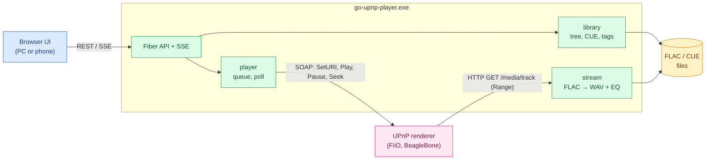

# go-upnp-player — Software Architecture Document (SAD)

A living document: how the system is built right now. It is updated in the same commit as the code.

## 1. Purpose and scope

A UPnP control point and a media server in one process. The program does not play sound
itself: it tells a renderer "play this URL", and the renderer downloads the track over HTTP
and decodes it on its own.



Control goes from the player to the renderer (SOAP); audio goes the other way: the renderer
pulls the track from the player over HTTP.

## 2. Components

```
cmd/player              startup: Fiber, routes, embedded UI, background polling
internal/handlers/h_*   transport: request parsing, responses
internal/services/svc_* pure logic with tests: CUE, WAV geometry, Range, DIDL,
                        queue advance decision, equalizer, MIME choice
internal/upnp           SSDP discovery, SOAP AVTransport/RenderingControl/ConnectionManager
internal/stream         FLAC → WAV for a sample range (+ equalizer), raw FLAC
internal/library        folder walk, cue, tags, cover art, metadata cache
internal/player         queue and commands to the selected renderer (package-level state)
internal/bg_workers     renderer poll every second, re-discovery every minute
internal/config         settings in %AppData%\go-upnp-player\config.json
web/                    React + React-Bootstrap (Vite); web/dist is embedded with go:embed
```

The UI keeps only per-viewer conveniences in the browser's `localStorage`: expanded tree
nodes (`go-upnp-player.tree.open`) and column widths (`react-resizable-panels:go-upnp-player.layout.*`).
The column splitters come from `react-resizable-panels`: Bootstrap/React-Bootstrap have no such
component. On a narrow screen (≤ 900 px) the columns stack and the splitters become horizontal.
Everything that must survive a browser change lives in `config.json` on the program side.

**No console, quit from the UI.** The exe is built with `-H=windowsgui`; the log goes to
`%LocalAppData%\go-upnp-player\go-upnp-player.log`. `POST /api/shutdown` (the ⏻ Quit button, two
clicks) takes the same path as Ctrl+C: pause the renderer, then
`app.ShutdownWithTimeout(3s)`. The timeout is needed because SSE and track streams never end
on their own. ~~A minimized console window as the way to stop it~~ — rejected 2026-11-09: the
window sits on the taskbar and is awkward to close.

**The playlist survives restarts.** The playlist (track IDs) and the current track index are
stored in `config.json` (`playlist`). They are written when a playlist is built with the arrow
button, when a track starts and when playback advances to the next track. On start the playlist
is restored but not played: Play resumes from the same track. The UI re-reads the playlist when
the library scan finishes, because IDs do not resolve to tracks until then.

**Single instance.** On start the process first binds the port (8090). If the port is busy and
`/api/state` of go-upnp-player answers on it, the process opens the browser on the running player
and exits with code 0; if something else answers, it is an error. A named mutex is not needed:
a busy port would stop a second copy from working anyway.

**Rename from upnp-player (2026-11-09).** The project, module, exe and data folders are now
`go-upnp-player`. Files from the old folders are read once as a fallback, so nothing is lost on
upgrade: `config.json` from `%AppData%\upnp-player` (the next save writes the new folder), the
metadata cache from `%LocalAppData%\upnp-player`, and the `upnp-player.tree.open` localStorage key.
Saved column widths are not carried over (they reset to the defaults once).

## 3. Playback flow

1. `Discover`: M-SEARCH from every IPv4 interface, then the device description and
   `GetProtocolInfo` (which MIME types the renderer accepts).
2. For each renderer the local IP that routes to it is determined (UDP dial). That address goes
   into the track URLs, so VPN, Hyper-V and WSL adapters do not get in the way.
3. Starting a track depends on the renderer state (`PlanSwitch`):
   - STOPPED / no media: `SetAVTransportURI(http://<ip>:8090/media/track/<id>.wav|.flac?ct=<mime>, DIDL)` → `Play`;
   - PLAYING or PAUSED: `SetNextAVTransportURI(target)` → `Seek` to the last second of the current
     track (→ `Play` if paused); the renderer moves to the target through its gapless path, and the
     player waits until `TrackDuration` matches the target before queuing the following track.
     Reason (2026-11-09, both renderers run gmrender): gmrender applies `SetAVTransportURI` only
     from STOPPED — while playing or paused it keeps the old song — and `Stop` hangs the FiiO SR11
     until a power cycle, from pause too. ~~SetAVTransportURI while playing~~,
     ~~Play to resume, then SetAVTransportURI~~ and ~~Pause → Stop → SetAVTransportURI~~ were
     tried live and rejected for those reasons.
4. Right after a track starts, `SetNextAVTransportURI` is sent for the next one (gapless).
   If the renderer does not support it, the poll performs the transition.
5. Poll every second: `GetTransportInfo` + `GetPositionInfo` → `DecideTick`:
   - the renderer moved to the next URI by itself — advance the index. A `TrackURI` change
     alone is not enough: gmrender (FiiO SR11, seen live 2026-11-09) reports the next track as
     current as soon as GStreamer has downloaded the current WAV into its buffer — minutes before
     the real transition — and also resets RelTime by a couple of seconds. The transition counts
     when `TrackDuration` becomes the next track's length; a position jump back counts only if
     both tracks have the same length;
   - STOPPED later than 4 s after our command — start the next track;
   - end of the queue — stop.

## 4. Serving tracks

- **A track from a CUE sheet** — a virtual WAV: a 44-byte header plus the PCM of the sample range
  `[INDEX 01 of the track; INDEX 01 of the next one)`. The next track's pregap stays at the end of
  the previous one. The length is known exactly, so `Content-Length` is honest. A Range request is
  mapped to a sample number: the decoder seeks to the frame via SEEKTABLE and drops the excess.
- **A plain track file** — the FLAC file as is, with Range support. With the equalizer on it also
  goes through WAV.
- The MIME type is picked from the renderer's list: the BeagleBone knows only `audio/x-wav`,
  the FiiO knows `audio/wav` as well.

## 5. CUE parsing — supported

- encodings: UTF-8 (with and without BOM), UTF-16 with BOM, otherwise cp1251;
- `FILE "x.wav"` with `x.flac` next to it; the only FLAC in the folder;
- several `FILE` entries in one cue; EAC "gaps appended" layout (INDEX 01 under the next FILE);
- a track without INDEX 01 is dropped, not the whole sheet; frame numbers ≥ 75 from broken rips
  are tolerated;
- a cue sheet in the `CUESHEET` tag inside a FLAC file.

Not supported: images other than FLAC (WAV, APE, WavPack), the binary CUESHEET block, DSD.

## 6. Equalizer

18 half-octave bands (55·2^(n/2): 55 Hz … ~19.9 kHz), ±20 dB, peaking biquads from the
RBJ Audio EQ Cookbook, Q = 2.0 (the textbook half-octave Q of 2.87 leaves dips between adjacent
bands). A band is skipped only above 0.475·fs, so the top band works at 44.1 kHz too. A saved set
for a different band grid is not remapped but reset to zero. ~~10 bands 31 Hz … 16 kHz,
±12 dB~~ — 2026-11-09: not enough.

There is no overall attenuation: boosting a band raises that band and leaves the rest alone.
Overload is handled by a soft limiter: linear up to −1 dBFS, above that peaks are rounded off
with tanh and never exceed full scale. ~~Preamp = −(largest boost)~~ — rejected 2026-11-09:
a +18 dB treble boost turned into "the whole track −18 dB, treble unchanged", i.e. near silence
instead of sparkle. Measured on "Never Say Die" with those settings: loudness +1.6 dB instead
of −18.

The settings live in an `atomic.Pointer`: open streams pick them up from the next FLAC frame.
The renderer buffers several seconds, so after a change the player re-requests the stream from
the current position (Seek). Turning the EQ on or off for a plain FLAC track changes the stream
type, so the track is restarted at the same position.

## 7. Decisions and rejected alternatives

- **Cut CUE tracks on the program side instead of serving the whole image + Seek.** Time-based
  seeking on renderers is imprecise, and the display would show the length of the whole album.
- **EQ on the program side.** gmrender's UPnP RenderingControl offers volume only.
- ~~`Stop` before `SetAVTransportURI`~~ and ~~`Stop` for the Stop button~~ — rejected 2026-11-09.
  On `AVTransport.Stop` during playback the FiiO SR11 brought its whole UPnP service down until
  a power cycle (a live incident). The Stop button now sends `Pause` and clears the intent to
  play; the next Play starts the track over. When switching renderers, the old one also gets
  `Pause`.
- **No modal dialogs**: everything is on one page (device, EQ and folders are cards on the right).
- **Navigation is the folder tree only.** Folders with nothing playable inside are hidden. A cue
  sheet expands into its tracks; track files are leaves. Nothing plays from the tree: the arrow
  button → on each row builds a playlist (a folder or a cue — everything inside; a file or a
  track — just that one; `PUT /api/queue`, playback is untouched). Only the playlist in the middle
  plays: the ▶ button on a track or Play in the top bar. Row buttons (→ in the tree, ▶ in the
  playlist) pop up on hover right after the label and are always visible on touch screens.
  Devices are a list in the Output card, selected with a Use button on hover.
  Rejected 2026-11-09: ~~double-click on a playlist track~~; ~~a dropdown for devices~~;
  ~~a central list of all tracks under the selected folder~~ (large folders produced thousands of
  rows to scroll); ~~double-click in the tree starts playback~~ (the tree is for navigation, the
  playlist is what plays).

## 8. Known issues

- The BeagleBone (gmrender) answers `Play` with `501 Playing failed` and does not even request the
  file (2026-11-09). The failure happens before any network access, inside GStreamer on the device:
  a busy ALSA output or a missing HTTP source element. Check the gmediarender log on the BeagleBone.
- Without a SEEKTABLE in the FLAC file every Range request decodes the file from the start up to
  the requested position.
